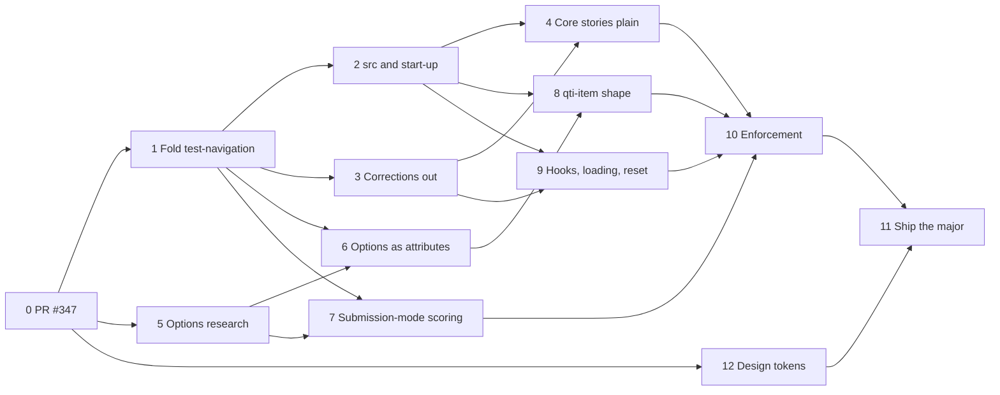

# Roadmap: building the host API on `next`

The order in which [host-api.md](host-api.md) is built. `host-api.md` says what the API is and holds
every decision; this file says what is built when, what waits on what, and where each phase stands.
A phase with research has its own plan, linked below.

Each phase is one branch, one worktree and one PR into `next`. The PR that ships a phase sets its
status here and ticks its steps in the same commit, so this file never runs behind the code. A phase
starts only when everything in **Needs** is `done`. When something found in a phase changes a
decision, the decision goes into `host-api.md` and the phase gets a line under **Found**.

## Dependencies

Critical path: 0 → 1 → 6 → 8 → 10 → 11. Can run side by side, in separate worktrees: 5 and 12 next to 1;
2 and 3 after 1; 7, 8 and 9 once their needs are done.

## Status

| #   | Phase                                           | Needs      | Status                   |
| --- | ----------------------------------------------- | ---------- | ------------------------ |
| 0   | Land PR #347                                    | none       | done (PR #347, 0f2339a8) |
| 1   | Fold `test-navigation` into `qti-test`          | 0          | todo                     |
| 2   | `src` on `qti-test` and start-up                | 1          | todo                     |
| 3   | Corrections out of the core                     | 1          | todo                     |
| 4   | Core stories in the plain markup                | 2, 3       | todo                     |
| 5   | Options against QTI: research and docs page     | 0          | todo                     |
| 6   | Options as attributes, `config` as a view       | 1, 5       | todo                     |
| 7   | Scoring that follows `submission-mode`          | 1, 5       | todo                     |
| 8   | `<qti-item>` has the shape of `<qti-test>`      | 2, 6       | todo                     |
| 9   | Hooks, `:state(loading)`, `reset`               | 2, 3       | todo                     |
| 10  | Enforcement                                     | 4, 7, 8, 9 | todo                     |
| 11  | Ship the major                                  | 10, 12     | todo                     |
| 12  | Design tokens: one source for the tier-1 inputs | 0          | todo                     |

## In every phase

- A changeset: `major` when it breaks, otherwise `minor` or `patch` (`next` is in pre mode).
- A host-migration entry for every host that uses a member the phase touches, linked from the changeset.
- A contract story for every member the phase adds or changes (#240), so phase 10 only closes gaps.
- A renamed or moved story moves its VRT baseline; a re-blessed PNG is checked, not trusted.
- Where the code and QTI or the 1EdTech conformance suite disagree, follow the suite literally. When
  the suite itself looks wrong, present the evidence and ask; never pre-pick a deviation or add a
  non-QTI switch to keep old behaviour. Hosts that break get a host-migration entry instead.
- `next` has no required checks, so `gh pr merge --auto` merges at once: wait for CI to pass
  (`gh pr checks <n> --watch --fail-fast`), then merge.

## Phases

### 0. Land PR #347

Plan: [host-api.md](host-api.md), the host-migration notes. Branch `feat/parts-states-vocabulary`.

- [x] Commit the plan updates (host-api, roadmap, the two research plans).
- [x] CI green, review, merge.

Done when: merged into `main` and synced into `next`.

### 1. Fold `test-navigation` into `qti-test`

Plan: [host-api.md](host-api.md) → Decided, "`test-navigation` folds into `qti-test`" (the three
units) and "`testHostContext` stays internal".
Scope: `packages/qti-test` (mixins, `qti-test`, `test-navigation`), `packages/qti-corrections`
(`TestNavigationCorrection` becomes part of its `qti-test` subclass).

- [ ] Move `test-navigation`'s body into one session-rules mixin or controller on `qti-test`,
      registered after the test model.
- [ ] Keep `afterAttemptEnded` and `activeAssessmentItem` as its protected extension point.
- [ ] `<test-navigation>`: a deprecated wrapper that listens to nothing and forwards its properties.
- [ ] Narrow `testHostContext` to the transform callback and `<template item-ref>`.

Done when: the attempts-used and end-attempt specs and the linear, sequencing and adaptive stories
pass with and without `<test-navigation>`, and the session-rules spec runs on its own.

### 2. `src` on `qti-test` and start-up

Plan: [host-api.md](host-api.md) → `<qti-test>` properties, Decided "Start-up is explicit" (#328).
Scope: `qti-test`, `test-container`, the state mixin.

- [ ] `src` on `qti-test`; `test-url` on `test-container` a deprecated alias.
- [ ] `state` may be a promise; the seed in `session.seed`; `start-at`; `navigate` defaults to `item`.

- [ ] Host-migration entries from #328: Kennisnet (no change), CitoTestUit (`state = fetchState()`
      instead of its own first `navigateTo`), qti-player (`start-at` instead of `navigateTo` on load).

The `item` default ships only together with the promise `state` and `start-at`. On its own it was
tried and reverted: CitoTestUit leaves `navigate` unset and navigates itself once its state is in, so
a default start would show item 1 first.

Done when: `<qti-test src="…"><test-container></test-container></qti-test>` loads and starts, the
#328 play functions pass (a sync state opens the saved item with one navigation; a promise state
resolving after load never shows item 1; `null` opens item 1; `start-at` wins; `section` restores
the section), and CitoTestUit's start-up is checked against the new contract.

### 3. Corrections out of the core

Plan: [host-api.md](host-api.md) → Decided "The core does not know the corrections package" (#245).
Scope: `packages/qti-corrections`, the four interaction `*.styles.ts` with `full-correct-response`
(match, gap-match, associate, order), `qti-base` config, the item and interaction docs.

- [ ] Every correction method, property, attribute and option lives on the corrections package's
      extended elements; `correctResponseMode` and `fullCorrectResponseOnlyWhenIncorrect` leave the
      core `ConfigContext`.
- [ ] Correction stories, specs and VRT baselines move into the corrections package.
- [ ] The core names no corrections package (the #245 list, and `qti-test.host.api.stories.ts`).

Done when: `grep` finds no correction member or package name in the core, and the core builds and
tests without `@qti-components/corrections` installed.

### 4. Core stories in the plain markup

Plan: this file. Scope: core stories in `packages/qti-test`, `qti-elements`, `interactions/*`.

- [ ] Every core test story uses
      `<qti-test src="…"><test-container></test-container><nav><test-prev></test-prev><test-next></test-next></nav></qti-test>`,
      with no delivery option set.
- [ ] A story that needs an option moves to the options docs page (phase 5).

Done when: no core story sets an option; any failure is a departure from QTI and gets a line under
Found, to be fixed or turned into an option.

### 5. Options against QTI: research and docs page

Plan: [options-against-qti.md](options-against-qti.md). Docs only; can start now.

Done when: that plan's "Done when".

### 6. Options as attributes, `config` as a view

Plan: [host-api.md](host-api.md) → Delivery options, Decided "Options are attributes", "One disable
option", "Names". Scope: `qti-base` config, `qti-test`, interactions core.

- [ ] Every option that survives phase 5 is an attribute with a reflecting property.
- [ ] `config` reads and merges; `configContext` a deprecated alias.
- [ ] `disableAtMaxChoices` replaces both disable options.
- [ ] `itemData` and `setOutcomes`; the old names deprecated aliases.

Done when: each option works set as an attribute and through `config`, and the deprecated names warn once.

### 7. Scoring that follows `submission-mode`

Plan: [submission-mode-scoring.md](submission-mode-scoring.md) (#299).

Done when: that plan's "Done when".

### 8. `<qti-item>` has the shape of `<qti-test>`

Plan: [host-api.md](host-api.md) → `<qti-item>`, Decided "`<qti-item>` has the shape of `<qti-test>`" (#236).
Scope: `packages/qti-item`.

- [ ] `src`, `xml`, `state`, `view`, `config`, `qtiContext`, `disabled`, `readonly`, the transform
      callback on `qti-item`; `item-container` keeps only the registry and the `<template><style>`.
- [ ] `QtiItemState` round-trips between a test and a standalone item; `qc-item-state-changed`.

Done when: an item state saved in a test restores into a `qti-item` and back.

### 9. Hooks, `:state(loading)`, `reset`

Plan: [host-api.md](host-api.md) → Hooks, Styling (#243), `<qti-test>` methods (#244).

- [ ] `qc-item-answer-key-shown` and `qc-item-correction-shown` (sent by the corrections package).
- [ ] `:state(loading)` on `qti-test` and `qti-item`.
- [ ] `reset(itemId?)` on `qti-test`, `reset()` on `qti-item`.

Done when: the Kennisnet table in Hooks has a story per row.

### 10. Enforcement

Plan: [host-api.md](host-api.md) → How this is enforced (#240, #251).

- [ ] Members not in `host-api.md` are `@internal` and stripped from the `.d.ts`; an API report in CI.
- [ ] The custom-elements manifest lists only the public members.
- [ ] Contract stories for every member; host-shaped tests (Kennisnet first).

- [ ] Before freezing: decide the host element names (`qti-test`, `qti-item`) against the `qti-`
      namespace policy (host-api.md → Open decisions).

Done when: CI fails on any change to the public surface that `host-api.md` does not list.

### 11. Ship the major

Plan: CLAUDE.md → Releasing.

- [ ] Survey PeilingLezen's 7.14 → 9.x gap.
- [ ] Every host-migration file complete for the major.
- [ ] Leave pre mode, merge `next` into `main`, release; cut `9.x` first.

### 12. Design tokens: one source for the tier-1 inputs

Plan: [design-tokens.md](design-tokens.md). Scope: `packages/qti-theme`, `tools/build`, the Theming
page, `.storybook/themes.css`, the docs site's styling guide. Touches no host-API code, so it runs
next to every other phase.

Done when: that plan's "Done when".

## Found

Things a phase found that changed the plan. Newest first.

- 2026-10-28: the Theming page set `--qti-spacing` and lacked ten tier-1 inputs; fixed by hand, and
  the reason for phase 12.
- 2026-10-27: `allowReorder` defaults to on (`config.context.ts:73`), not off (phase 5).
- 2026-10-27: the corrections package subclasses `TestNavigation`, so phase 3 needs phase 1's extension point.
- 2026-10-27: `testHostContext` is also read by `test-container` and the item-refs; it stays, narrowed (phase 1).
