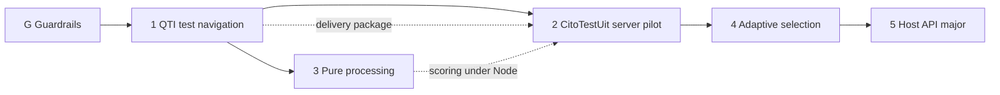

# The main roadmap

Everything we plan to build on `next`, and everything QTI 3 has that we do not support yet, in one
place. Work that is ready to build is a sub-roadmap with phases; the rest has a slot here (see
"Not yet in a sub-roadmap"), so nothing we miss is out of sight. This file also holds what the
sub-roadmaps share: the guardrails, the rules for every phase and what was found.

## The sub-roadmaps, in order

| #   | Roadmap                                                                     | Starts                            | Status |
| --- | --------------------------------------------------------------------------- | --------------------------------- | ------ |
| 1   | [QTI test navigation](roadmap-qti-navigation.md) (T0–T8)                    | after G1; now                     | todo   |
| 2   | CitoTestUit server pilot (below)                                            | when roadmap 1 is done            | slot   |
| 3   | [Response processing as pure functions](roadmap-pure-processing.md) (P1–P3) | when roadmap 1 is done, next to 2 | todo   |
| 4   | [Adaptive selection (CAT)](roadmap-adaptive-selection.md) (A1–A4)           | when roadmap 2 is done            | todo   |
| 5   | [The host API major](roadmap-host-api.md) (phases 2–16)                     | when roadmap 4 is done            | todo   |



- **1** makes QTI 3 test parts complete: navigation and submission mode, item session control, the
  processing order between items, test-part boundaries, selection, ordering and time limits. Its
  rules live in `@qti-components/delivery`, a public package (0.x) with no browser globals, so
  they can run on a server.
- **2** tries server delivery with CitoTestUit: the same `delivery` code on a Node server, the
  browser sending commands and showing what the server answers. Scoring is the .NET
  [qti-scoring-engine](https://github.com/Citolab/qti-scoring-engine): the client sends only the
  responses, the server reads default outcomes from the item XML and returns the outcomes. The
  engine reads QTI Results Reporting 2.x `assessmentResult`s, so the pilot has one adapter from the
  session state to that envelope and back (or the engine gets a JSON endpoint). A slot until it
  gets a plan.
- **3** makes response, outcome and template processing pure functions, the same code in the
  custom elements and under Node. Not needed by 2, which scores in .NET; it runs next to it.
- **4** adds `qti-adaptive-selection`: a section whose items an external CAT engine chooses (IMS
  CAT 1.0), on 1's model and lifecycle.
- **5** builds the host API in [host-api.md](host-api.md) on top of 1–4 and ships the major.

The guardrails (G) run next to all of them. The licence stays GPL-3.0 (decided 2026-10-30).
Results Reporting is out of scope (decided 2026-10-30); it has a row below.

## Not yet in a sub-roadmap

What QTI 3 has that no sub-roadmap builds yet. Read from the elements the library registers and the
names its source mentions on 2026-10-30, not run against the conformance suite; each row is
checked when it gets a phase.

| QTI                                                                                                       | Today                     | Slot                 |
| --------------------------------------------------------------------------------------------------------- | ------------------------- | -------------------- |
| Results Reporting (`assessmentResult`, `itemResult`, `testResult`)                                        | not supported             | out of scope for now |
| Template rules: `qti-template-condition`, `qti-set-default-value`, `qti-template-default` on the item-ref | not found in source       | after roadmap 5      |
| Template content: `qti-template-block`, `qti-template-inline`                                             | not found in source       | after roadmap 5      |
| `qti-outcome-processing-fragment`, `qti-variable-mapping`                                                 | not found in source       | after roadmap 5      |
| `qti-drawing-interaction`                                                                                 | not found in source       | after roadmap 5      |
| Companion materials: `qti-calculator`, `qti-protractor`, `qti-rule`                                       | not found in source       | after roadmap 5      |
| Accessibility catalogs and PNP: `qti-catalog-info`, `qti-catalog`, `qti-card`                             | mentioned, not registered | after roadmap 5      |

Not QTI features, but slots of their own:

| What                                                                      | Today                              | Slot                    |
| ------------------------------------------------------------------------- | ---------------------------------- | ----------------------- |
| A processor for response, outcome and template processing without the DOM | processing runs as custom elements | roadmap 3               |
| `test-container` holding only the current item, not the whole test        | the whole test is in the DOM       | roadmap 2 (CitoTestUit) |
| A .NET port of `delivery`, checked against roadmap 1's test vectors       | none                               | after roadmap 2         |

Test navigation (everything about moving through a `qti-assessment-test`) is in roadmap 1's "QTI
test support" table; adaptive selection is roadmap 4.

## How phases work

Each phase is one branch, one worktree and one PR into `next` (or one PR per step, where it says
so). The PR that ships a phase sets its status in its roadmap and ticks its steps in the same
commit, so no roadmap runs behind the code. A phase starts only when everything in **Needs** is
`done`. When something found in a phase changes a decision, the decision goes into `host-api.md`
and the phase gets a line under **Found** here.

## Decided before the phases: the accessibility gate

Decided 2026-10-28; built in the guardrails work (G4). Not built yet.

Every story is checked by axe (`@storybook/addon-a11y`), and a violation fails the story, locally
and in CI: `a11y: { test: 'error' }` in `.storybook/preview.ts`, which today has `'todo'` locally
and `'off'` in CI, so axe fails nothing.

A story opts out only with the `a11y-todo` tag and a reason that names an issue or a phase:

```ts
export const Default: Story = {
  // a11y-todo: #412 hotspot areas have no accessible name
  tags: ['a11y-todo']
};
```

- The tag is `a11y-todo`, never `todo`: `todo` means "placeholder", and vitest skips those stories
  entirely.
- One story at a time: never on a file's `meta`, and never by switching off a single axe rule.
- The tagged stories are the list of known violations. It is visible in the sidebar as a badge
  (`.storybook/manager.ts`, next to `todo` and `xfail`) and through the tag filter, and it only
  shrinks. The stories that fail when the gate goes on get the tag, with a reason that names this
  work.

How it is enforced:

- `.storybook/preview.ts`:
  - a `beforeEach` turns the tag into `parameters.a11y.test = 'todo'` (the addon reads only the
    parameter, never tags);
  - an `afterEach` fails a tagged story once its axe report is `passed`
    ("axe passes now: remove the a11y-todo tag"), so a fix must remove the tag.
- `story-policy.spec.ts` fails on an `a11y-todo` tag with no `// a11y-todo: #123 …` or `phase N`
  reason above it.
- Review catches a new story that arrives with the tag; nothing else stops it.

To check when building it:

- whether `parameters` changed in the project's `beforeEach` reach the addon's `afterEach`;
- whether the project's `afterEach` runs after the addon's, so the report exists when it looks.

If not, the stale check moves into a vitest setup file, as `.storybook/vitest.vrt.setup.ts` does.

## In every phase

- A changeset: `major` when it breaks, otherwise `minor` or `patch` (`next` is in pre mode).
- A host-migration entry for every host that uses a member the phase touches, linked from the changeset.
- A contract story for every member the phase adds or changes (#240), so roadmap 5's phase 10 only closes gaps.
- A renamed or moved story moves its VRT baseline; a re-blessed PNG is checked, not trusted.
- Where the code and QTI disagree, QTI wins, in this order (decided 2026-10-28; it replaces "follow
  the suite literally"): the XSD for structure, then the spec text for behaviour, then the 1EdTech
  conformance suite. When two of them disagree, present the evidence and ask; never pre-pick a
  deviation or add a non-QTI switch to keep old behaviour. Hosts that break get a host-migration
  entry instead.
- The rules in `CLAUDE.md` and `.claude/rules/` apply to every phase; a phase that has to break one
  says so in its PR and changes the rule in the same commit.
- `next` has no required checks, so `gh pr merge --auto` merges at once: wait for CI to pass
  (`gh pr checks <n> --watch --fail-fast`), then merge.

## G. Guardrails: the rulebook and its checks

Plan: this section. Decided with the user on 2026-10-28, topic by topic; the decisions are the rules
in `CLAUDE.md` and `.claude/rules/`. Each step is its own PR into `next`.

- [ ] **G1** One rulebook and the Claude setup: `CLAUDE.md` is the one instruction file (`AGENTS.md`,
      `SKILLS.md` and `.github/skills/` folded in), path-scoped rules, permissions and git hooks for
      Claude, skills, two read-only reviewer agents, `.mcp.json` with the QTI servers.
- [ ] **G2** `guidance-references.spec.ts` (every path and script a rule names exists) and
      `story-policy.spec.ts` (suffix taxonomy, one docs story per component, `query-exception:`,
      reasons on `todo`/`xfail`/`a11y-todo`, the `storySort` table of contents), each with a
      shrink-only list of today's violations.
- [ ] **G3** Every fixture validates against the QTI 3 XSD (pinned to the suite's version); first
      measure which Invalid Examples the XSD rejects, the rest are rejected by the runtime and their
      stories assert it.
- [ ] **G4** CI gates: `tsc` over stories, specs and tools; the accessibility gate above; `astro check`
      and build; changeset presence; Chromatic removed; and, once confirmed, `prettier --check`,
      stylelint over `*.styles.ts`, ESLint on `tools/**/*.mjs`, code under `docs/` out of the skip
      filter.
- [ ] **G5** The design-system contract as specs, generic over the CEM: every `part=` has `@csspart`
      and every `:state()` has `@cssstate`; interactions work with no theme; states never reflow;
      the `--qc-*` inputs the theme reads equal the tier-1 list and the Theming page; JSDoc on every
      host-api member; the CONTRACT §6 VRT guard restored.

Done when: CI fails on a broken rule reference, a story outside the taxonomy, an invalid fixture, an
axe violation without `a11y-todo`, a type error in a story or spec, and an undocumented part or state.

## Found

Things a phase found that changed the plan, in either roadmap. Newest first.

- 2026-10-30: `delivery` is public (0.x), not private; the pilot scores with the .NET
  qti-scoring-engine, sending only responses; response processing as pure functions is its own
  roadmap 3, next to the pilot; Results Reporting is out of scope. Adaptive selection and the host
  API major are now 4 and 5.
- 2026-10-30: the rules of roadmap 1 go into a private package, `@qti-components/delivery`, with no
  browser globals, to keep server delivery possible; a CitoTestUit server pilot is roadmap 2, so
  adaptive selection, the host API major and results reporting are now 3, 4 and 5.
- 2026-10-30: this file became the main roadmap: four sub-roadmaps in order (QTI test navigation,
  adaptive selection, the host API major, results reporting) and a table of what QTI has that none
  builds yet. Navigation gained T7 (test-part boundaries) and T8 (processing order).
- 2026-10-30: the one roadmap is split in two: QTI test navigation first (T1–T6, with phase 7 as
  T6), then the host API major (phases 2–16). Phase numbers are kept.
- 2026-10-30: phase 0 (land PR #347: host-api, this roadmap, the research plans) was done
  (0f2339a8) and is out of the table; 2, 5 and 12 need nothing.
- 2026-10-30: phase 1 (fold `test-navigation` into `qti-test`) is dropped; `test-navigation` stays.
  Phases 2, 3, 6, 7 and 14 no longer wait for it. `host-api.md` → Decided marks the fold withdrawn.
- 2026-10-30: `computedContext` is read from the live DOM, mishandles nested sections, carries four
  of seven session-control attributes and reads `navigation-mode` off sections, which QTI
  defines on the test part only; the T track (T1–T3) fixes that.
- 2026-10-28: the Theming page set `--qti-spacing` and lacked ten tier-1 inputs; fixed by hand, and
  the reason for phase 12.
- 2026-10-27: `allowReorder` defaults to on (`config.context.ts:73`), not off (phase 5).
- 2026-10-27: the corrections package subclasses `TestNavigation`, so phase 3 needs phase 1's extension point.
- 2026-10-27: `testHostContext` is also read by `test-container` and the item-refs; it stays, narrowed (phase 1).
