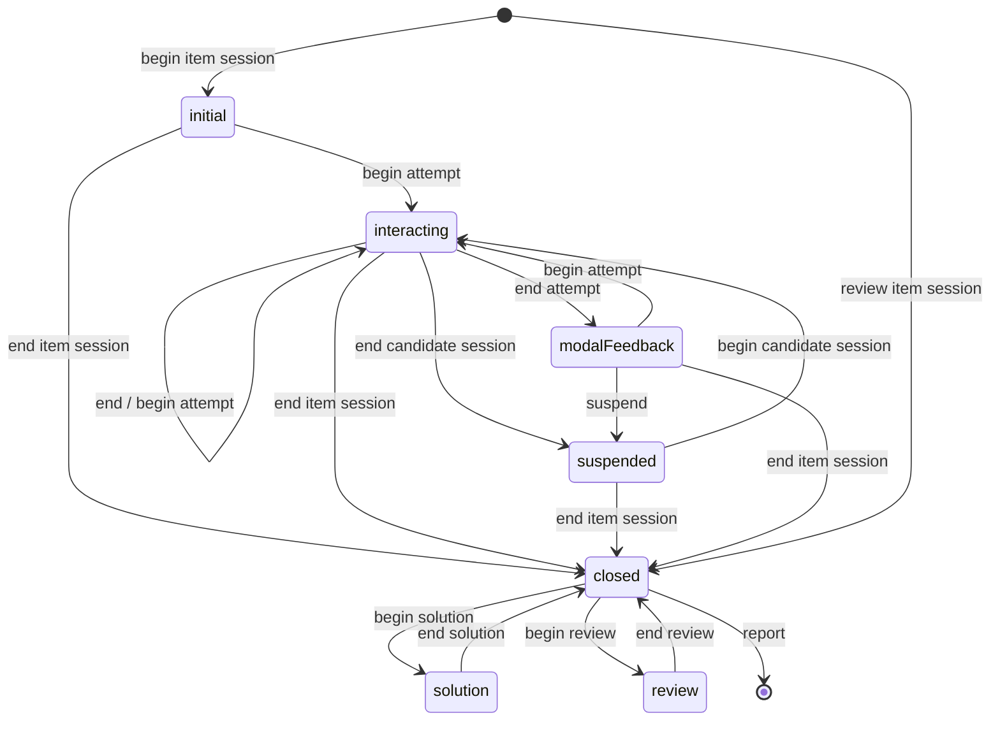

# The item session lifecycle

Roadmap phase T3. Needs phase T1 ([test-model.md](test-model.md)); runs next to phase T2
([computed-context.md](computed-context.md)). Phase T6 builds on its simultaneous-part
transitions. Decisions go into [host-api.md](host-api.md); this
file is deleted when the phase ships. Found by reading source on 2026-10-30, checked against the
QTI 3 info model.

## The problem

The rules are re-derived by five actors: `test-navigation` (done, lock, auto-score), `test-next`,
`test-prev`, `test-end-attempt` and `qti-feedback` each work out attempts left, skipping, linear
restrictions or feedback on their own. The lifecycle QTI gives every item session exists only as
scattered booleans (`done`, the item lock, `showFeedback`, the corrections overlay, the scorer
view).

## The lifecycle

QTI 3 info model §2.2.1 (Figure 2.1). Here it becomes one finite state machine per item-ref, so
every item goes through the same states, and every rule is a guard on one of its transitions.

What QTI ties to the states and transitions (§2.2.1–2.3):

- **begin attempt** adds 1 to `numAttempts`; the first one sets `completionStatus` from
  `not_attempted` to `unknown` and applies response defaults. An item that goes from `initial`
  straight to `closed` keeps NULL responses.
- **end attempt** runs response processing. A non-adaptive item resets its outcomes first; an
  adaptive one keeps them.
- **interacting** is the only state in which interactions are enabled. In `closed` and `review` the
  responses show but are disabled; in `solution` the correct responses show instead.
- **closed** fixes the response values. It is entered when no attempt is left: `max-attempts`
  reached (0 is unlimited, ignored for adaptive items), or an adaptive item set
  `completionStatus` to `completed`.
- **duration** counts `interacting` only, not `suspended`.

QTI says a delivery engine "may support only a limited number" of these transitions and maps them
to its own events. The guards and the mapping, proposed, to check with `/qti-spec-check`:

| Transition        | Guard                                                             | Our event                                  |
| ----------------- | ----------------------------------------------------------------- | ------------------------------------------ |
| begin attempt     | attempts left                                                     | item shown the first time; "try again"     |
| end attempt       | individual submission; with `validate-responses`, valid responses | submit / `test-end-attempt`; next (linear) |
| → modalFeedback   | `show-feedback` and attempts left                                 | after response processing                  |
| end cand. session | none                                                              | candidate leaves the item                  |
| begin cand. sess. | nonlinear part, or not yet left in a linear part                  | candidate returns to the item              |
| end item session  | no attempts left; or the test part ends                           | after processing; part submit; test end    |
| begin review      | `allow-review`                                                    | review view after the part                 |
| begin solution    | `show-solution`                                                   | the corrections overlay                    |
| add a comment     | `allow-comment`; `interacting`                                    | a host's or plugin's comment field         |

In a simultaneous part every attempt ends together when the part is submitted (phase T6), so an
item goes `interacting ⇄ suspended` during the part and `closed` at its end.

## Target shape

- The machine and the rules module live in `@qti-components/delivery` (roadmap 1, T0), with no
  browser globals.
- The machine is a pure `transition(state, event, guards) → state`, with guards read from the test
  model, the item facts and the variables. Each item's state is in `computedContext` and in the
  persisted test state, so a resumed session comes back in the same state.
- The rules module is a pure function `(model, facts, state) → answers`: per item `done`,
  `attemptsUsed`, `mayEndAttempt`, `maySkip`, `mayShowFeedback`, `mayShowSolution`, `mayReview`,
  plus the navigation answers `mayGoNext` and `mayGoPrevious`. It sends the machine its events. It
  is a function `test-navigation` calls, not a controller (`.claude/rules/lit.md`).
  `test-navigation` keeps `afterAttemptEnded` and `activeAssessmentItem` as its protected
  extension point, which the corrections package's `TestNavigationCorrection` overrides.

Decided 2026-10-30: a plain transition table. A typed
`Record<State, Partial<Record<Event, Target>>>` and one function, no dependency. A spec walks every
(state, event) pair, about 70, so a missing or extra transition fails, and a spec checks that the
mermaid above matches the table. XState v5 (visualiser, generated test paths) and robot3 were
weighed and rejected: a runtime dependency in a published package, and the persisted test state
would hold the library's snapshot format.

## Decide before the steps

- **`allow-comment`.** QTI lets the candidate leave a comment while interacting, reported in the
  item result. Carry only (recommended): `sessionControl.allowComment`, a `comment` in the item
  state and a request to set it, with the field left to a host or a qti-extended plugin. Or a
  comment field of our own.

## Steps

Each step is one PR into `next`.

- [ ] **T3a** The item session machine: the transition table, its guards from session control, the
      item facts and submission mode, and the exhaustive transition spec. Each item's state in
      `computedContext` and in the persisted test state. Runs alone, before anything reads it.
- [ ] **T3b** The rules module drives the machine: navigation and the buttons send its events;
      `test-next`, `test-prev`, `test-end-attempt`, `qti-feedback`, the corrections overlay and the
      item lock read its state instead of deriving their own.

- [ ] **T3c** `validate-responses` and `allow-comment`: end attempt is refused while a response is
      invalid in an individual part with `validate-responses` (the `qc-test-navigation-failed`
      shape); the comment as decided above.

Order: T3a, then T3b and T3c.

## Done when

- Every item session is in exactly one lifecycle state, and only the table's transitions happen.
- Every reader of attempts, skipping, feedback or linear navigation reads the rules module.
- All seven session-control attributes have an effect, each asserted by a story or spec.
- The attempts-used and end-attempt specs and the linear, sequencing, adaptive and feedback stories
  pass.
