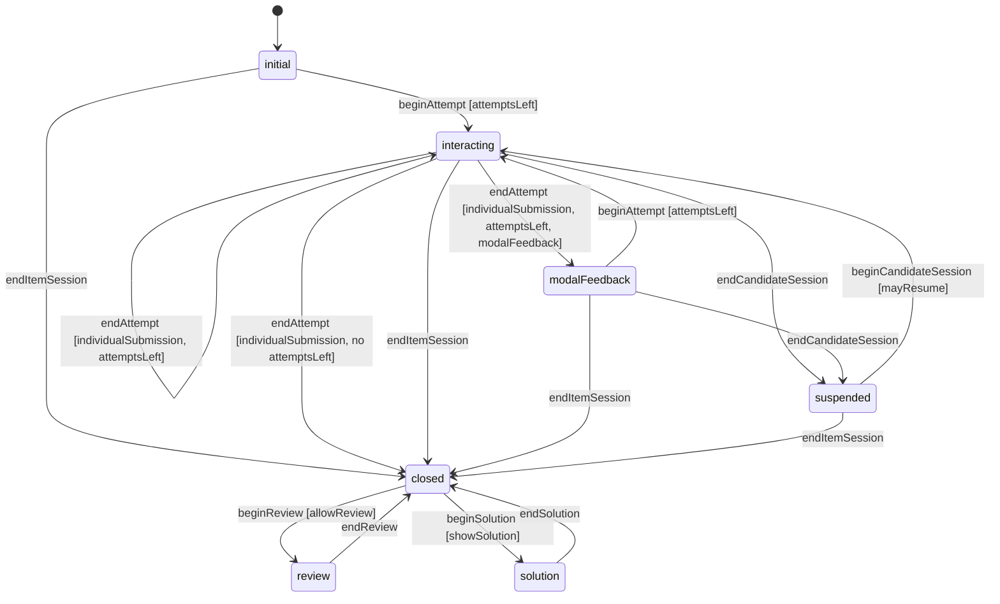

# The item session lifecycle

Roadmap phase T3. Needs phase T1 (done); runs next to phase T2
([computed-context.md](computed-context.md)). Phase T6 builds on its simultaneous-part
transitions. Decisions go into [host-api.md](host-api.md); this
file is deleted when the phase ships. Found by reading source on 2026-10-30, checked against the
QTI 3 info model.

## The problem

The rules are re-derived by five actors: `test-navigation` (done, lock, auto-score), `test-next`,
`test-prev`, `test-end-attempt` and `qti-feedback` each work out attempts left, skipping, linear
restrictions or feedback on their own. The lifecycle QTI gives every item session exists only as
scattered booleans (`done`, the item lock, `showFeedback`, the corrections overlay, the scorer
view).

## The lifecycle

QTI 3 info model §2.2.1 (Figure 2.1). Here it becomes one finite state machine per item-ref, so
every item goes through the same states, and every rule is a guard on one of its transitions. The
table and its diagram are `ITEM_LIFECYCLE` in `packages/qti-delivery/src/lifecycle/item-lifecycle.ts`
(T3a); a spec keeps the diagram and the table equal.

What QTI ties to the states and transitions (§2.2.1–2.3):

- **begin attempt** adds 1 to `numAttempts`; the first one sets `completionStatus` from
  `not_attempted` to `unknown` and applies response defaults. An item that goes from `initial`
  straight to `closed` keeps NULL responses.
- **end attempt** runs response processing. A non-adaptive item resets its outcomes first; an
  adaptive one keeps them.
- **interacting** is the only state in which interactions are enabled. In `closed` and `review` the
  responses show but are disabled; in `solution` the correct responses show instead.
- **closed** fixes the response values. It is entered when no attempt is left: `max-attempts`
  reached (0 is unlimited, ignored for adaptive items), or an adaptive item set
  `completionStatus` to `completed`.
- **duration** counts `interacting` only, not `suspended`.

QTI says a delivery engine "may support only a limited number" of these transitions and maps them
to its own events. The guards and the mapping, checked against implementation guide §4.1 and
§4.4.2 on 2026-11-27:

| Transition        | Guard                                                             | Our event                                  |
| ----------------- | ----------------------------------------------------------------- | ------------------------------------------ |
| begin attempt     | attempts left                                                     | item shown the first time; "try again"     |
| end attempt       | individual submission; with `validate-responses`, valid responses | submit / `test-end-attempt`; next (linear) |
| → modalFeedback   | attempts left and response processing set modal feedback          | after response processing                  |
| end cand. session | none                                                              | candidate leaves the item                  |
| begin cand. sess. | nonlinear part, or not yet left in a linear part                  | candidate returns to the item              |
| end item session  | no attempts left; leaving it in a linear part; or the part ends   | after processing; next (linear); part end  |
| begin review      | `allow-review`                                                    | review view after the part                 |
| begin solution    | `show-solution`                                                   | the corrections overlay                    |
| add a comment     | `allow-comment`; `interacting`                                    | a host's or plugin's comment field         |

In a simultaneous part every attempt ends together when the part is submitted (phase T6), so an
item goes `interacting ⇄ suspended` during the part and `closed` at its end.

## Target shape

- The machine and the rules module live in `@qti-components/delivery` (roadmap 1, T0), with no
  browser globals.
- The machine is a pure `transition(state, event, guards) → state`, with guards read from the test
  model, the item facts and the variables. Each item's state is in `computedContext` and in the
  persisted test state, so a resumed session comes back in the same state.
- The rules module is a pure function `(model, facts, state) → answers`: per item `done`,
  `attemptsUsed`, `mayEndAttempt`, `maySkip`, `mayShowFeedback`, `mayShowSolution`, `mayReview`,
  plus the navigation answers `mayGoNext` and `mayGoPrevious`. It sends the machine its events. It
  is a function `test-navigation` calls, not a controller (`.claude/rules/lit.md`).
  `test-navigation` keeps `afterAttemptEnded` and `activeAssessmentItem` as its protected
  extension point, which the corrections package's `TestNavigationCorrection` overrides.

Decided 2026-10-30: a plain transition table. A typed
`Record<State, Partial<Record<Event, Target>>>` and one function, no dependency. A spec walks every
(state, event) pair, about 70, so a missing or extra transition fails, and a spec checks that the
mermaid above matches the table. XState v5 (visualiser, generated test paths) and robot3 were
weighed and rejected: a runtime dependency in a published package, and the persisted test state
would hold the library's snapshot format.

## Decided

Settled with the user on 2026-11-27, and recorded in [host-api.md](host-api.md) → Decided:

- **No "optimal" stop.** Attempts are limited by `max-attempts` (or `completionStatus` for an
  adaptive item) only (implementation guide §4.4.2.1). `test-end-attempt` stays enabled while
  attempts are left, also after an optimal attempt, and Next in a linear part closes the item
  whatever attempts are left (§4.1). `optimal` stays in `computedContext` as information. T3b, with
  host-migration entries.
- **Next in a linear individual part ends the attempt** of an item whose attempt was not ended,
  then closes it; skipping is Next with no response, blocked by `allow-skipping="false"` while the
  response is the default and by `validate-responses` while it is invalid. T3b and T3c.
- **`allow-comment`: carry only**: `sessionControl.allowComment`, a `comment` in the item state and
  a request to set it; the field is a host's or a plugin's. T3c.

From this plan (2026-10-30) or the QTI text, not asked again:

- **Not a controller or a mixin**: the table and the rules are pure functions in `delivery` that
  `test-navigation` calls (`.claude/rules/lit.md`).
- **`allow-skipping` and `validate-responses` are separate rules** (implementation guide
  §4.4.2.6–7): today `allow-skipping="false"` also refuses an invalid response; from T3c only
  `validate-responses` does. A behaviour change for hosts, with host-migration entries.

Chosen in T3a, for the user's review:

- **`modalFeedback` is a lifecycle state.** The text of §2.2.1 names six states (`initial`,
  `interacting`, `suspended`, `closed`, `review`, `solution`); modal feedback is shown "directly
  following response processing" (§2.6), and this plan's reading of Figure 2.1 (2026-10-30) has it as
  a state; the figure itself was not checked in T3a (the spec tools give its text only).
  Kept apart from `interacting` so a resumed session knows the candidate was reading feedback, and
  `delivery-state.md`'s `lifecycle` lists seven states.

## A version 1 state

A stored version 1 `QtiTestState` has no `lifecycle`. T3d derives it, per item, from what it has:

- `numAttempts` 0 and not on screen → `initial`;
- no attempts left (`hasAttemptsLeft`: a non-adaptive item that reached `max-attempts` above 0, an
  adaptive one with `completionStatus` `completed`) → `closed`;
- an item before the current one in a linear part → `closed`;
- the current item → `interacting`; any other → `suspended`.

`closed` follows the attempts, never optimality. `stored-states.spec.ts` keeps passing.

`numAttempts`: QTI counts an attempt when it begins (info model §2.2.1, "begin attempt"); our items
count it when response processing ends it (`processResponse`). The guards answer the same at every
decision point either way, but a state stored mid-attempt differs by one. T3d keeps the items' count
(ended attempts) in `DeliveryState.numAttempts`, as version 1 states hold it, and says so; moving to
QTI's count is a change of the items, outside T3.

## Steps

Each step is one PR into `next`.

- [x] **T3a** The item session machine: the transition table, its guards from session control, the
      item facts and submission mode, the exhaustive transition spec and JSON vectors, all in
      `@qti-components/delivery`. Runs alone, before anything reads it; each item's state reaches
      `computedContext` in T3b and the persisted state in T3d.
- [ ] **T3b** The rules module drives the machine: navigation and the buttons send its events;
      `test-next`, `test-prev`, `test-end-attempt`, `qti-feedback`, the corrections overlay and the
      item lock read its state instead of deriving their own.

- [ ] **T3c** `validate-responses` and `allow-comment`: end attempt is refused while a response is
      invalid in an individual part with `validate-responses` (the `qc-test-navigation-failed`
      shape); the comment as decided above.

- [ ] **T3d** `lifecycle`, `numAttempts` and `completionStatus` in `DeliveryState` (with
      `parseDeliveryState` and the state vectors); a version 1 state derives `lifecycle` as above;
      the `can*` flags derived, never stored.

Order: T3a, then T3b and T3c, then T3d.

## Done when

- Every item session is in exactly one lifecycle state, and only the table's transitions happen.
- Every reader of attempts, skipping, feedback or linear navigation reads the rules module.
- All seven session-control attributes have an effect, each asserted by a story or spec.
- The attempts-used and end-attempt specs and the linear, sequencing, adaptive and feedback stories
  pass.
