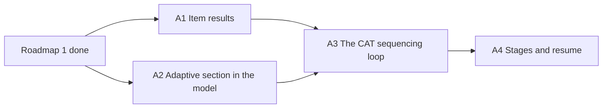

# Roadmap 4: adaptive selection (CAT)

The fourth sub-roadmap (see [ROADMAP.md](ROADMAP.md)): `qti-adaptive-selection`, a section whose
items an external CAT engine selects and orders one by one, through the IMS Computer Adaptive
Testing 1.0 API. It starts when roadmap 2, the CitoTestUit server pilot, is done; it builds on
[roadmap 1](roadmap-qti-navigation.md). The rules in
[ROADMAP.md](ROADMAP.md) → "In every phase" apply. Plans are written before each phase starts.

## What QTI says

QTI 3 implementation guide §4.5 and info model §2.8.4. After an attempt in an adaptive section:

1. the candidate ends the attempt and the response variables are set;
2. response processing and outcome processing run;
3. the delivery engine calls the CAT engine's Submit Results endpoint with the new values and any
   item results not sent yet; with unpresented items left in the stage it may wait;
4. the item is submitted; with Results Reporting, the report merges our outcomes with the outcome
   values the CAT engine returned;
5. the items the CAT engine returned are added to the end of the section;
6. the next item is presented.

Steps 1, 2 and 6 are roadmap 1's lifecycle and processing order (T3); 3–5 are new.

## Dependencies

## Status

| #   | Phase                         | Needs  | Status |
| --- | ----------------------------- | ------ | ------ |
| A1  | Item results                  | none   | todo   |
| A2  | Adaptive section in the model | none   | todo   |
| A3  | The CAT sequencing loop       | A1, A2 | todo   |
| A4  | Stages and resume             | A3     | todo   |

"none" means nothing beyond roadmap 1.

## Phases

### A1. Item results

- [ ] An item session becomes a QTI Results Reporting `itemResult`: its lifecycle state (T3), its
      response, outcome and template variables, `numAttempts`, `duration` and `completionStatus`.
- [ ] A pure function in `delivery` over the session state; the CAT engine is sent these.

Done when: an `itemResult` validates against the Results Reporting schema for each lifecycle state.

### A2. Adaptive section in the model

- [ ] `qti-adaptive-selection` and its engine reference read into the T1 model; a section with it
      has no static item list.
- [ ] How a host gives the engine's endpoint and credentials: a host-API decision in
      [host-api.md](host-api.md) first.

Done when: the model of the 1EdTech CAT sample package (implementation guide §6.2.14) names the
adaptive section and its engine.

### A3. The CAT sequencing loop

- [ ] Create a CAT session on entering the section; after each attempt, Submit Results with the
      A1 item results; append the returned items; present the next (QTI steps 3–6).
- [ ] The engine's returned outcome values merge into the test outcomes.
- [ ] A failed call is a `qc-test-navigation-failed`, not a stuck test.

Done when: a story with a mocked CAT engine runs an adaptive section to its end.

### A4. Stages and resume

- [ ] Deferred Submit Results while unpresented items remain in a stage.
- [ ] The CAT session and the items it returned are in the persisted test state, so a resumed test
      continues the same adaptive path.

Done when: a test resumed mid-section gets the same next item as it would have uninterrupted.
