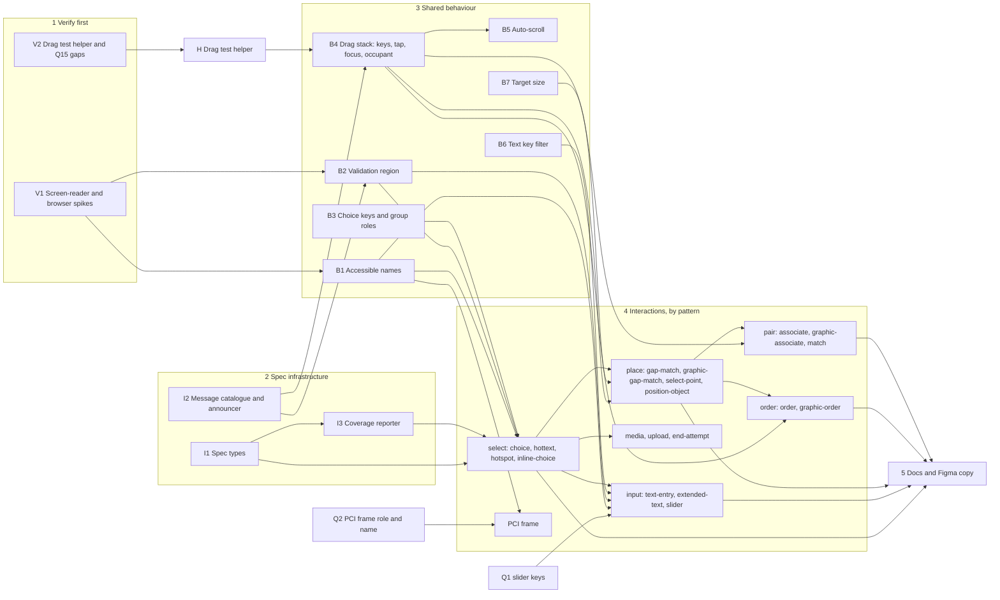

# Behaviour spec: how a candidate operates each interaction

Roadmap 6 (see [ROADMAP.md](ROADMAP.md)), accepted 2026-11-18: F-10 and C2 ship in 10.0, F-11 in
11, the rest in 10.x minors. One source of truth per QTI interaction for **how a candidate operates it and which states
it has**, so every interaction behaves predictably, above all for keyboard, focus and assistive
technology. Drafted 2026-11-12. Nothing here is built. The schema decisions D1–D7 and most keyboard,
focus and announcement rows were decided with the author on 2026-11-12 (see "Decisions" and the
Status column); what is still open is marked Open. The rules in [ROADMAP.md](ROADMAP.md) → "In every
phase" apply.

## Why

- QTI 3 prescribes little of this (below). Everything else is our design space, and today it lives
  only in code, so two interactions can disagree and nothing says which one is right.
- The parts and states vocabulary is already decided (`packages/qti-theme/CONTRACT.md` §3). What
  nothing models is the other half: key bindings, focus targets, transitions and announcements.
- Readers: engineers and agents (plain files in the repo), designers and accessibility reviewers
  (rendered docs, later a Figma copy).

## Review this first: the accessibility guidelines

For the party that has a say in how this is implemented. **Status** says how settled a row is:

- **QTI**: the spec text says it; we follow it, QTI wins (`CLAUDE.md` → "Rules everywhere").
- **Decided**: already a rule in this repo, or decided with the author (the cell gives the date).
- **Proposed**: our reading of WCAG 2.x / WAI-ARIA practice, not yet agreed. The WCAG numbers are from
  memory and are checked against the W3C text before this plan is accepted.
- **Open**: a real question; the reviewer's answer changes what we build.

| #   | Guideline                                                                                                                                       | Applies to                | Source                                                  | Status   | Question for the reviewer                                                    |
| --- | ----------------------------------------------------------------------------------------------------------------------------------------------- | ------------------------- | ------------------------------------------------------- | -------- | ---------------------------------------------------------------------------- |
| K1  | Every interaction is fully operable by keyboard, including every state change.                                                                  | all                       | QTI impl §5.2.3; WCAG 2.1.1                             | QTI      | **Decided 2026-11-12: three accepted exceptions.** (1) Freehand drawing (`qti-drawing-interaction`, not built yet): path-dependent input, the WCAG 2.1.1 exception. (2) Third-party PCIs: the host guarantees only Tab in and out (C3); keyboard-only candidates are assigned to forms whose PCIs are known to work (QTI impl §5.2.3). (3) Pixel precision on select-point and position-object: they stay keyboard operable, but a point moves in steps by keyboard: an arrow moves 1% of the image, Shift+arrow 10%, and the coordinates (in the image's own units) are announced after a pause (decided 2026-11-12). Everything else is fully keyboard operable, including media, upload, graphic gap-match snapping and graphic-associate lines. |
| K2  | A candidate with the PNP `input-requirements` of `full-keyboard-control`, `full-mouse-control`, `full-switch-control` or `full-touchscreen-control` can do everything with that input alone; other inputs stay available. | all                       | QTI impl §5.2.9.2                                       | QTI      | **Decided 2026-11-12: stories prove every row by keyboard, mouse and touch (`pointerType` touch, tap-to-place); switch is covered by the manual matrix in S1** (not automatable in a browser test; it mostly maps to focus and activate). |
| K3  | Pointer and keyboard drive the same states and the same response (one transition table, two bindings).                                          | all                       | CONTRACT §3 rule 8                                      | Decided  | none                                                                         |
| K4  | Focus never gets trapped: Tab or Shift+Tab always leaves an interaction, and so does Escape for anything modal.                                 | all                       | WCAG 2.1.2                                              | Decided  | **Decided 2026-11-12: Tab cancels the pick-up (as Escape) and focus moves on.**                               |
| K5  | Tab order follows document order. Choices that are hotspots are offered in the order they are written.                                          | hotspot, graphic-order    | QTI info §5.67 (hotspot-choice)                         | QTI      | none                                                                         |
| K6  | A choice is activated on one named key phase, the same for every choice-style interaction.                                                      | choice, hottext, … | none                                                    | Decided  | **Decided 2026-11-12: mirror the native button: Enter on keydown, Space on keyup, for buttons and for picking up chips. Choices follow the native radio and checkbox: Space toggles, arrows pick in a radio group, Enter does nothing (D9; amended the same day).** Today: choice uses keyup for both, drag starts on keydown, so the active-element mixin changes. |
| K7  | Keyboard drag is a pick-up, move, place or cancel sequence, with Escape to cancel. Tab does not place.                                          | every drag interaction    | WCAG 2.5.7 (dragging alternative)                       | Decided  | **Decided 2026-11-12: Space or Enter picks up (phases as K6), arrows cycle the targets, Space or Enter places, Escape cancels, Tab cancels.** Today Tab places, so the drag mixin changes.      |
| K8  | A dragged item can be placed without dragging: pick, then target (select-then-place).                                                           | every drag interaction    | WCAG 2.5.1, 2.5.7                                       | Decided  | **Decided 2026-11-12: add tap-to-pick then tap-to-place alongside dragging**, for touch and switch users; it needs a pointer mode and a state in the drag stack, designed in S3. (Reads as WCAG 2.5.7; to be checked in S0.) **Also decided 2026-11-12, for drag and tap alike (K3 parity): a chip placed on a full single-capacity slot sends the occupant back to the bank** (a chip already in another slot still swaps). Today the drag refuses a bank chip on a full slot, so the drag mixin changes; QTI is silent on this. It removes the need for a "slot is full" refusal message. Open for S3: how a tap is told apart from the start of a drag.                             |
| K9  | A text control keeps the platform's own keys; we do not swallow keystrokes.                                                                     | text-entry, extended-text | WCAG 2.1.1                                              | Decided  | **Decided 2026-11-12: stop printable keys only** (letters, digits and punctuation without Ctrl, Alt or Meta); Tab, Escape, Enter, arrows and modifier combinations propagate. Likely reason for the stop: the field sits in a shadow root, so an outside listener sees the event retargeted to the interaction element, and a "skip editable targets" check (Storybook's `s`, a host's single-key shortcut) fails. Rejected: stop nothing (every host hits that trap), keep as is (Tab, Escape and host keys never arrive). History: today both stop `keydown` from propagating, with no reason in the code. Evidence so far: typing an `s` in a field in Storybook toggles Storybook's sidebar each time, which is probably why; no other listener is known to need the key while a field has focus.              |
| K10 | A control that takes focus and announces a role can be operated by the keys that role promises (a slider: arrows, Home, End, PageUp, PageDown).   | slider                    | WCAG 2.1.1, 4.1.2                                       | Decided  | **Decided 2026-11-12: keep the custom slider and add the keys** (arrows by step, Home, End, PageUp, PageDown), a name from the prompt, `aria-valuetext`, and orientation and `reverse`. Rejected: native `<input type=range>` (cannot reach today's rail, ticks and the corrections ghost knob).                |
| F1  | The focused part is visible at all times, in light, dark and high-contrast themes, on a mouse pick too (except a chip until release).          | all                       | WCAG 2.4.7; CONTRACT §3 (focus ring)                    | Decided  | none                                                                         |
| F2  | Focus is never lost: after a placement, removal or reset it lands on a named target (the placed item, the next item, or the control).          | drag, order, associate    | WCAG 2.4.3                                              | Decided  | **Decided 2026-11-12: focus follows the chip** (after a place it stays on the chip in its target; after a return or removal it goes to the chip in the bank; if that is not there, to the interaction).                                                |
| F3  | Focus and selection are two states that can hold together (focused, selected, both, neither).                                                   | all choice-style          | QTI vocab §1.2.6.3                                      | QTI      | none                                                                         |
| R1  | Every control has an accessible name, role and value (checked, selected, current value).                                                        | all                       | WCAG 4.1.2; QTI impl §3.7.9.1                           | Decided  | **Decided 2026-11-12: the roles in the overview table are the target**, with ARIA through `ElementInternals` on our custom elements; S1's screen-reader matrix confirms each role and a failing one is revisited (match's `grid` first: partial support). Rejected for now: rendering native inputs inside the shadow roots (a large rewrite). |
| R2  | State is carried by ARIA, not by colour or position alone.                                                                                      | all                       | WCAG 1.4.1; QTI impl §3.7.9.1                           | Decided  | accepted 2026-11-12                                                                         |
| R3  | Content authored with ARIA attributes (all 47 are allowed on every interaction) is passed through, not overwritten.                             | all                       | QTI info (ARIABase)                                     | Decided  | **Decided 2026-11-12: authored ARIA always wins** (QTI allows it; consistent with R4). Known cost, accepted: an authored `aria-checked` or `aria-valuenow` can hide the real answer from a screen reader. `ElementInternals` ARIA acts as a default that an authored attribute overrides, so the mechanism fits.                        |
| R4  | Every interaction has an accessible name, never empty, so a screen-reader user hears the question when entering it. For a block interaction: authored ARIA (`aria-label`, `aria-labelledby`), else its `qti-prompt` (`aria-labelledby`), else a generated name from the message catalogue (D4). | all                       | WCAG 4.1.2, 3.3.2; QTI info (ARIABase)                  | Decided  | **Decided 2026-11-12, amended the same day: authored ARIA, else the prompt, else a generated name.** The QTI `label` attribute is never a name: QTI defines it as data for authoring systems ("labelling elements of the content model with application specific data"). |
| R6  | An inline interaction (no `qti-prompt` in QTI) is named by authored ARIA, else its QTI hint (`placeholder-text` on text entry, which QTI says is for vocalising the interaction in speech environments; `data-prompt` on inline choice), else a generated name ("Answer 2 of 3"). The surrounding sentence is its description, because QTI requires the candidate to review the answer in the context of the surrounding text. | text-entry, inline-choice | QTI info §5.162 (text-entry); QTI vocab (inline choice `data-prompt`); WCAG 4.1.2 | Decided  | **Decided 2026-11-12.** The input sits in the interaction's shadow root and the sentence outside it, so an id reference cannot cross. Element references (`ariaDescribedByElements`) can; browser support is checked in S1, with a visually hidden copy of the sentence inside the shadow root as the fallback. |
| R5  | A group of choices always has a group role: `radiogroup` for one answer, `group` for several (not no role).                                     | choice, hottext, hotspot  | WCAG 4.1.2                                              | Decided  | accepted 2026-11-12                                                                         |
| A1  | A change of state is announced (picked up, placed, removed, full, too many, selected value) without moving focus.                               | all                       | WCAG 4.1.3                                              | Decided  | **Decided 2026-11-12: routine events are polite (`role="status"`), validation errors and refused actions assertive (`role="alert"`); each catalogue entry carries its politeness; rapid moves are throttled.** The catalogue itself: see D4.         |
| A2  | A validation message is announced as it appears.                                                                                                | all                       | WCAG 3.3.1, 4.1.3                                       | Decided  | **Decided 2026-11-12: keep the per-interaction `role="alert"` region, but always in the tree and empty when there is no message (no `display: none`), see A5.**           |
| A3  | A candidate is told about keyboard use that is not standard, through the `keyboard-directions` support.                                         | drag, order, graphic      | QTI impl §5.2.7.4 ("best practice")                     | Decided  | **Decided 2026-11-12 (end of this cell).** Preference stated: do not deviate from what is standard, which would also remove the need for separate instructions. Finding: no formal standard for keyboard drag exists (the ARIA drag attributes are deprecated); the de facto convention (dnd-kit) is Space or Enter to lift and drop, arrows to move, Escape to cancel, which our K7 matches; and WCAG 2.5.7 names native alternatives (move up/down buttons, move-to menus, direct input) as acceptable. **Decision: no native-control alternative (no menus or up/down buttons) and no upfront instructions.** The non-drag path is one pick-up and put-down model: a tap, Space or Enter picks a chip up (K7), a tap on a slot or arrows plus Enter puts it down, Escape or Tab cancels. The only instruction is a just-in-time message when a chip is picked up ("X picked up. Choose a slot, or press Escape to cancel."), from the message catalogue (D4), polite (A1). Rejected: per-chip or per-slot menus and buttons (a control on every chip, unlike the interaction, reordering becomes a form task).       |
| A4  | `data-qti-suppress-tts` is honoured on every interaction.                                                                                       | all                       | QTI vocab §1.1.1.3                                      | QTI      | none                                                                         |
| A5  | The validation live region is in the accessibility tree before it has text (never created or un-hidden in the same moment as its text), and is linked to the control (`aria-describedby`, `aria-invalid`). | all                       | WCAG 3.3.1, 4.1.3                                       | Decided  | **Decided 2026-11-12: one always-present region per interaction, linked to the control with `aria-describedby` and `aria-invalid`; no item-level summary for now** (it would touch the host API).                           |
| A6  | A PCI announces through a live region in its own document; the host adds no relay.                                                              | PCI                       | WCAG 4.1.3                                              | Decided  | **Decided 2026-11-12: no relay message type** (the PCI messaging contract is shared across QTI players, so a type only we understand goes unused). Checked 2026-11-12 with VoiceOver and Safari on a sandboxed `srcdoc` frame (as our PCI): polite and alert messages inside the frame are both announced. JAWS and NVDA still to run; revisit only if they fail. |
| V1  | A selected or filled state is visible beyond colour and has enough contrast against the background.                                             | all                       | WCAG 1.4.1, 1.4.11; QTI vocab §1.2.10.3                 | Decided  | accepted 2026-11-12                                                                         |
| V2  | `qti-unselected-hidden` hides only visually; the selections stay in the accessibility tree and keyboard order, and low-vision PNP overrides it. | hottext, graphic gap match | QTI vocab §1.2.6.3, §1.2.10.3                           | QTI      | none                                                                         |
| V3  | Targets are large enough to hit, and a drag snaps to the nearest valid position.                                                                | graphic*, gap-match       | QTI info §5.60; WCAG 2.5.8                              | QTI (snap), Decided (size) | **Decided 2026-11-12: our own controls (chips, slots, gaps, buttons, the slider knob, remove buttons) are at least 24×24 CSS px (WCAG 2.5.8, AA); authored hotspot shapes are exempt and a story warns when one is smaller.** |
| V4  | Choices placed in a gap sit wholly inside it where possible and never hide each other completely.                                               | graphic-gap-match         | QTI info §5.60                                          | QTI      | none                                                                         |
| P1  | Answer masking: with the PNP, choices are hidden visually **and** programmatically, on by default, announced as masked, and removable by the candidate. | choice | QTI impl §5.2.9.4 | QTI | **Decided 2026-11-12: built with the PNP work (roadmap slot "Accessibility catalogs and PNP"), but the choice spec reserves it now:** a masked mode, an unmask action and its catalogue messages. The state name goes into CONTRACT §3 when it is built. |
| P2  | Selection points show only what the candidate placed, never the scoring areas.                                                                  | select-point              | QTI info §5.128                                         | QTI      | none                                                                         |
| P3  | A slider shows its current value; an untouched slider and a NULL response cannot be told apart, so the item decides how to score it.            | slider                    | QTI info §5.134                                         | QTI      | none                                                                         |
| C1  | The PCI frame is named uniquely from the item (authored ARIA, else its prompt, else a generated "Interactive question N", as R4), by one attribute (`title`); the inner document `<title>` and `lang` match. | PCI                       | WCAG 4.1.2, 2.4.1                                       | Decided  | **Decided 2026-11-12, amended the same day: the R4 order (authored ARIA, prompt, generated); never QTI's `label`.**          |
| C2  | The PCI frame has no `role="application"`: it keeps the native frame role, so browse-mode navigation by headings and landmarks still works.     | PCI                       | MDN and screen-reader vendor guidance; not tested here  | Decided  | **Decided 2026-11-12: the frame drops `role="application"`; a PCI that is a desktop-like widget sets it on its own container inside its document.** Verified per screen reader in S1; a host-migration note for PCI authors. |
| C3  | Tab enters and leaves the PCI frame. The host cannot enforce this inside the frame, so it is stated in the PCI authoring guidance. | PCI                       | WCAG 2.1.2                                              | Decided  | **Decided 2026-11-12: documented in the PCI authoring guidance only**; no runtime check (no reliable signal) and no per-PCI story. K1's PCI exception covers keyboard-only candidates. |
| C4  | The prompt, instructions and validation message outside the frame are tied to the iframe element (`aria-describedby`), because ARIA references do not cross the frame. | PCI                       | WAI-ARIA (id references are per document)               | Decided  | accepted 2026-11-12                                                                         |
| C5  | The candidate's text appearance, contrast and magnification needs (PNP) reach the content inside the frame.                                      | PCI                       | QTI impl §5.2.9 (text appearance, high contrast)        | Decided  | **Decided 2026-11-12: the host reads the values from the interaction itself (not `document.body`), adds background and the contrast or colour theme, and sends them at load and again whenever they change; the PCI guidance says a PCI should inherit them.** Today: font family, size, line height, weight and colour are copied once from `document.body` at load. |
| T1  | Every rule above that can be checked in a browser is a story with a `play` function using real user events, plus axe.                           | all                       | `.claude/rules/stories.md`; accessibility gate (G4)     | Decided  | none                                                                         |

What QTI does **not** say, and what this plan therefore designs: key bindings, focus management, ARIA
roles and live announcements per interaction, a keyboard path for order, gap-match, match, associate,
graphic-order and slider, and pointer–keyboard parity. WCAG 2.1 is only named as "best practice".
This was read through the QTI MCP on 2026-11-12; the 1EdTech Elevated Accessibility conformance
criteria are **not read yet** (step S1).

## Overview per interaction: the behaviour we want

"Proposed" unless a guideline row above has decided it: this is the target for review. State names are CONTRACT §3's
and none are new. **Today** is what the code does, taken from a grep of `packages/interactions` on
2026-11-12. It is **to be verified** (S1) and is not a statement of current behaviour in general.

Five patterns carry most of it; each interaction below is a pattern plus its differences.

| Pattern  | Meaning                                                              | Interactions                                                              |
| -------- | -------------------------------------------------------------------- | ------------------------------------------------------------------------- |
| `select` | choose from a set, one or several                                    | choice, hottext, hotspot, inline-choice                                   |
| `place`  | put a chip on a target, or a mark on an image                        | gap-match, graphic-gap-match, select-point, position-object               |
| `order`  | arrange a set into a sequence                                        | order, graphic-order                                                      |
| `pair`   | connect two things                                                   | associate, graphic-associate, match                                       |
| `input`  | type or set a value                                                  | text-entry, extended-text, slider                                         |

Not a pattern, on their own: media, upload, end-attempt, custom, portable-custom.

| Interaction                     | Pattern  | The candidate can…                                                          | Keyboard (proposed)                                                                                                      | Role and announcements (proposed)                                                                          | Today, to verify                                                                       |
| ------------------------------- | -------- | --------------------------------------------------------------------------- | ------------------------------------------------------------------------------------------------------------------------ | ---------------------------------------------------------------------------------------------------------- | -------------------------------------------------------------------------------------- |
| `qti-choice-interaction`        | select   | pick one, or up to `max-choices`; unpick; see "too many"/"too few"          | `max-choices`=1: one Tab stop, arrows move and pick (native radio group, D9). More: each choice a Tab stop, Space (keyup) toggles (native checkbox, D9); Enter does nothing (K6) | radio group or checkbox group; announce picked, unpicked, and the max-choices message; answer masking (P1) | Space and Enter both activate on keyup (`active-element.mixin.ts`); each choice is a `radio` or `checkbox` through `ElementInternals` with `aria-checked` kept in step; the interaction is a `radiogroup` only when `max-choices` is 1, otherwise it has no role; no name from the prompt; validation region is `role="alert"`    |
| `qti-hottext-interaction`       | select   | pick words in running text                                                  | as choice; Tab order is reading order                                                                                    | the text keeps its flow; each hottext announces selected and not selected                                  | `role="alert"` validation region                                                       |
| `qti-hotspot-interaction`       | select   | pick areas of an image                                                      | Tab in document order (K5); Space picks, as a native checkbox (D9, K6)                                                   | each area needs a name (`hotspot-label`); announce picked and unpicked                                     | `role="alert"` validation region; area names not verified                              |
| `qti-inline-choice-interaction` | select   | choose one option from a menu inside a sentence                             | open: Enter, Space or ArrowDown; arrows move; Enter or Space picks; Escape closes and returns focus to the trigger       | trigger plus listbox, named per R6 (authored ARIA, `data-prompt`, generated), the surrounding sentence as description; announce the chosen value | custom listbox exists with exactly these keys (`qti-inline-choice-interaction.ts`)      |
| `qti-gap-match-interaction`     | place    | put a chip in a gap, move or return it, fill a gap with several (`match-max`) | Tab to a chip, pick up, arrows move between gaps, place; Escape or Tab cancels (K7); or tap to pick up and tap a gap (K8) | announce picked up (with the just-in-time hint, A3), over gap N, placed in gap N, occupant returned to the bank, returned to bank | Space or Enter picks up (keydown), arrows cycle the targets with wrap-around, Space, Enter or **Tab** places, Escape cancels (`drag-drop-core.mixin.ts`); nothing is announced               |
| `qti-graphic-gap-match-interaction` | place | the same, onto hotspots of an image                                         | as gap-match; snap to nearest valid hotspot (V3); overlapping choices never fully hidden (V4)                            | as gap-match; hotspot names; selections stay available when `qti-unselected-hidden` (V2)                    | not read                                                                               |
| `qti-select-point-interaction`  | place    | click points on an image; remove one                                        | focus the image, arrows or a virtual cursor move, Enter places; Delete removes the focused point — **open: not specified by QTI** | announce coordinates and count; never reveal the scoring areas (P2)                                         | not read                                                                               |
| `qti-position-object-interaction` | place  | place one object (`max-choices`) on an image and move it                    | Enter or Space picks up, arrows move, Escape cancels, Delete or Backspace removes                                        | `role="button"` on the object and its points; announce position                                            | has exactly these keys (`qti-position-object-interaction.ts`)                          |
| `qti-order-interaction`         | order    | arrange all or some (`min/max-choices`) choices in a sequence               | pick up an item, arrows move it, place; Escape or Tab cancels (K7); or tap to pick up and tap a slot (K8)                | announce "item X, position 2 of 5", picked up, moved, placed                                               | drag stack; keyboard parity not verified                                               |
| `qti-graphic-order-interaction` | order    | number the hotspots of an image in order                                    | Tab in document order (K5); Space numbers the next position; a way to unnumber                                           | announce the number given; hotspot names                                                                   | `role="alert"` validation region                                                       |
| `qti-associate-interaction`     | pair     | connect two choices (`max-associations`)                                    | the place sequence (D11): pick up a chip, arrows cycle the pair boxes, place; Escape or Tab cancels; or tap a chip and tap a box | announce first picked, pair made, pair removed, "already used up"                                          | drag stack                                                                             |
| `qti-graphic-associate-interaction` | pair | connect two hotspots of an image                                            | Enter or Space on the first, then the second; Escape cancels; Delete or Backspace removes                                | `role="button"` on hotspots; announce pair made                                                            | has exactly these keys (`qti-graphic-associate-interaction.ts`)                        |
| `qti-match-interaction`         | pair     | tick cells of a grid linking rows to columns (`match-max`)                  | arrow keys across the grid, Space toggles a cell                                                                         | grid with row and column headers; `aria-checked` on cells; announce row and column on focus                | already a `role="grid"` with `aria-checked`                                            |
| `qti-text-entry-interaction`    | input    | type a short answer                                                         | platform keys only (K9); validation on blur and on submit, never per keystroke                                           | named per R6 (authored ARIA, `placeholder-text`, generated), the surrounding sentence as description; announce a validation message on submit | stops `keydown` propagation                                                            |
| `qti-extended-text-interaction` | input    | type a longer answer, with format and length limits                         | platform keys only (K9)                                                                                                  | native textarea name; `expected-length` and `pattern-mask` communicated, not enforced by blocking keys      | stops `keydown` propagation                                                            |
| `qti-slider-interaction`        | input    | set a number between `lower-bound` and `upper-bound` in `step`s              | arrows by `step`, Home and End to the bounds, PageUp and PageDown by a larger step; orientation and `reverse` respected | `role="slider"` with value, min, max; announce the value (P3)                                              | focusable (`tabindex` 0), `role="slider"`, min, max and now are set; **mouse and touch handlers only, no key handling**, no name, no `aria-valuetext`                                                  |
| `qti-media-interaction`         | other    | play, pause, replay within `max-plays`                                      | the platform's media keys; the remaining plays are announced                                                             | native media controls; announce "plays left"                                                               | not read                                                                               |
| `qti-upload-interaction`        | other    | choose a file                                                               | the platform's file control                                                                                              | native input                                                                                               | not read                                                                               |
| `qti-end-attempt-interaction`   | other    | end the attempt                                                             | a button: Space and Enter                                                                                                | button name; announce the result                                                                           | not read                                                                               |
| `qti-custom-interaction`, `qti-portable-custom-interaction` | other | whatever the PCI does                                                       | a PCI owns its keyboard; the host only guarantees Tab in and Tab out (K4)                                                | a uniquely named frame with the native role (C1, C2); the PCI owns its own semantics inside; C3 to C5 | iframe has `role="application"`, the same `title` and `aria-label` "QTI PCI Iframe" for every PCI, and a redundant `aria-hidden="false"` (`qti-portable-custom-interaction.ts:743-747`); the inner document has `lang` but the generic `<title>` "QTI PCI Container"                     |

Differences worth a decision, not only a row (D9–D11 below): choice with `max-choices`=1 as radio or
as toggle; whether `place` and `order` share one keyboard sequence; whether `pair` uses
pick-then-pick everywhere.

## Findings from a first read of the code (2026-11-12)

Read from source in `packages/interactions` and `packages/qti-base`; **not run** with a screen reader.
Each is input to S1, not fixed here, and each maps to a guideline above.

| #   | Finding                                                                                                                                                                                                                         | Where                                                                     | Guideline |
| --- | ------------------------------------------------------------------------------------------------------------------------------------------------------------------------------------------------------------------------------------------- | ------------------------------------------------------------------------- | --------- |
| F-1 | The slider is focusable and announces `role="slider"` with a value, but only mouse and touch move it. A keyboard or screen-reader user lands on it and cannot change it. This is worse than no role.                             | `slider-interaction/src/qti-slider-interaction.ts`                        | K1, K10   |
| F-2 | The PCI iframe has `role="application"`, one generic name for every PCI, and a redundant `aria-hidden="false"`.                                                                                                                | `portable-custom-interaction/src/qti-portable-custom-interaction.ts:743`  | C1, C2    |
| F-3 | Nothing in the interactions or base package uses `aria-labelledby`, `aria-describedby`, `aria-live` or `role="status"`. So no interaction is named by its prompt, no validation message is tied to a control, and no state change is announced. | whole of `interactions`, `qti-base`                                       | R4, A1, A5 |
| F-4 | The validation region is `role="alert"`, hidden with `display: none` and shown by setting text and `display` together. Announcement depends on timing and the screen reader.                                                     | `qti-base/src/abstract/interaction.ts:335`, `qti-base/src/styles/validation-message.styles.ts` | A2, A5    |
| F-5 | Choice items are `radio` or `checkbox` through `ElementInternals` and keep `aria-checked`, which is the right shape. The interaction is a `radiogroup` only for `max-choices` 1, otherwise it has no role at all.                  | `core/src/mixins/active-element`, `core/src/mixins/choices/choices.mixin.ts:198` | R1, R5    |
| F-6 | Choice activation is on keyup for both Space and Enter. A native button activates Enter on keydown and Space on keyup, so Enter differs from the platform. A keyup that starts as a keydown elsewhere can also fire here. (The native-button behaviour is from my knowledge, not re-checked.) | `core/src/mixins/active-element/active-element.mixin.ts:184`              | K6        |
| F-7 | Keyboard drag picks up on keydown, cycles targets with arrows and wraps round, and Space, Enter **and Tab** all place the chip. Escape cancels. Focus follows the target only if the target has a `tabindex`. Nothing is announced at any step, and the chips carry no instructions. | `core/src/mixins/drag-drop-observables/drag-drop-core.mixin.ts:538`       | K4, K7, F2, A1, A3 |
| F-8 | `aria-ordervalue` on a hotspot choice is not an ARIA attribute (the code says so). An unknown `aria-*` attribute is likely to fail axe's valid-attribute rule.                                                                  | `core/src/elements/qti-hotspot-choice/qti-hotspot-choice.ts:19`           | R1, T1    |
| F-9 | Text entry and extended text stop `keydown` from propagating, so a host or plugin key binding never sees keys typed in them.                                                                                                    | `text-entry-interaction`, `extended-text-interaction`                     | K9        |
| F-10 | Order does not implement QTI's `min-choices` and `max-choices`; it reads the non-QTI `min-associations` and `max-associations` (its own JSDoc says so). With a subset, a chip left in the bank means "not part of the answer"; without one, every choice must be placed. **Decided 2026-11-18: order reads only `min-choices` and `max-choices`, with no alias; ships in 10.0** ([host-api.md](host-api.md) → Decided, with what TAO, QTI.JS, Amp-up and QTI-Editor do). | `order-interaction/src/qti-order-interaction.ts`                          | QTI info §5.97, K8 |
| F-11 | A QTI ordered response has no gaps, but a candidate can fill slot 3 with slots 1 and 2 empty, and `getResponse` returns one string per slot, so an empty slot comes out as `''`. **Confirmed (V2, 2026-11-12):** our story `Q15-L1-D6` asserts `['', '', 'A']`. The 1EdTech suite itself could not be read (not reachable from here); `Q15-L1-D6` to `D9` look like our own scenarios named as criteria (D9 tests our `validationDisplayMode` option). **Open, moved to 11 (2026-11-18)**, to discuss with colleagues; it also touches the corrections package. Until then the response stays as it is (`['', '', 'A']`, free placement, gaps allowed) and `Q15-L1-D6` is unchanged. This withdraws the decision of 2026-11-12 (a gap makes the interaction invalid, NULL while a gap is open). The options, and what TAO, QTI.JS and Amp-up do: [host-api.md](host-api.md) → Open decisions. | `qti-order-interaction.ts` (`getResponse`)                                | QTI impl §3.2.10 |
| F-12 | `orientation` is a hint that the ordering has an inherent direction; where the choices sit against the targets is the `qti-choices-top`, `-bottom`, `-left`, `-right` vocabulary. How the component reads both was not checked. | `qti-order-interaction.styles.ts`                                         | QTI vocab §1.2.9.3 |
| F-13 | The drag test helper sends synthetic mouse and pointer events (`fireEvent`, `isTrusted` false), and the drag code's pointer path ignores untrusted events, so the 28 story files that use it only exercise the mouse fallback, which starts a drag at once. The path real users take (pointer, with the 10 ms / 100 ms delay) is untested. The helper moves in steps (default 20, `duration` ignored), sends mouse only (no touch), and cannot hold still (no press-and-hold, no dwell at an edge). **Decided 2026-11-16: one helper with two engines** (step H below): real browser input under Vitest, synthetic pointer events in the Storybook UI, so play functions still run visibly there. Rejected: real input only (drag play functions would stop working in the Storybook UI), and synthetic events only (the real input path stays untested). | `tools/testing/drag.ts`, `drag-drop-core.mixin.ts` (pointerdown filter) | B4, B5, K2 |

What looked right: ARIA state is written through `ElementInternals` (not attributes) so it does not clash with
author-supplied ARIA; `aria-grabbed` and `aria-dropeffect` are not used (they are deprecated); inline-choice
is a complete listbox with Arrow, Enter, Space and Escape; match is a real `grid` with `aria-checked`;
graphic-associate and select-point name their remove buttons.

## Design: what the spec holds (options, not a choice)

Layer 1 is **not restated**: parts and states stay in CONTRACT §3 and the CEM (`@csspart`,
`@cssstate`, roadmap G5). The spec adds only what nothing models today.

- **Dimensions per part**: independent axes (availability, selection, focus, validation, drag) with
  `excludes` for impossible combinations. They map to Figma variant properties later.
- **Modes and transitions** (the new content): modes such as `idle` and `carrying`; a transition has
  `from`, an abstract event (`grab`, `move-target`, `drop`, `cancel`), a guard, `to`, a focus target,
  the response effect and an `announce`. Keyboard and pointer each bind to the events, so parity (K3)
  becomes checkable.
- **Keyboard map**: a closed vocabulary of actions with mode guards and a key phase.
- **Coverage**: each row is proven by a story with a `play` function. How the rows and stories are
  tied together is open (below).
- **Source of truth is the repo**, never Figma or prose: nothing tests those, so they go stale. Figma
  receives a downstream copy through story states.

## Decisions

For the author of the schema; each needs the trade-off shown, then a decision. D1–D7 were decided on
2026-11-12, and D8–D11 the same day.

| #   | Decision                                                                                  | Options                                                                                                       | Status                                         |
| --- | ----------------------------------------------------------------------------------------- | ------------------------------------------------------------------------------------------------------------- | ---------------------------------------------- |
| D1  | Unit of a spec                                                                            | **Decided 2026-11-12: shared patterns plus per-interaction differences.** Rejected: one spec per interaction (shared rules copied, will drift)                                             | decided                                        |
| D2  | State model                                                                               | **Decided 2026-11-12: both layers** (dimensions per part plus modes and transitions). Rejected: dimensions only (cannot express sequences), modes only (visual states not first-class)                                                                      | decided                                        |
| D3  | Are focus and hover dimensions in the spec, or theme rules in CONTRACT?                   | **Decided 2026-11-12: focus is a dimension in the spec; hover stays a theme rule in CONTRACT.** Rejected: both in the spec (untested hover matrix), both in CONTRACT (focus targets, F2, would have no home)                                                                                      | decided                                        |
| D4  | Announcements                                                                             | **Decided 2026-11-12: a closed catalogue of messages** (ids with parameters; transitions refer to an id; tests assert the id). The lookup layer is a new abstraction, so its design is proposed and approved in S2. Rejected: free text per row (wording drifts, translation scattered)                                                             | decided                                        |
| D5  | Format                                                                                    | **Decided 2026-11-12: TypeScript with `satisfies`** (no new dependency). Rejected: YAML plus a JSON Schema validator (new dependency, ids not checked by tsc) | decided                                  |
| D6  | Coverage bookkeeping                                                                      | **Decided 2026-11-12: a Vitest reporter over `task.meta`** (stories tag the row they prove; the reporter lists rows with no passing test). It is new tooling, so its design is proposed and approved in S2 before it is built. Rejected: `satisfies Record<RowId, PlayFn>` (proves a function exists, not that it runs); one generated story per row; a grep (cannot see a skipped test) | decided |
| D7  | Is a pattern row tested once per pattern or once per interaction?                         | **Decided 2026-11-12: once per interaction.** Rejected: once per pattern (an interaction that drifts is never caught)                                                                        | decided                                        |
| D8  | The behaviour questions in the guideline table                                            | All decided 2026-11-12: K1, K2, K4, K6, K7, K8, K9, K10, F2, R1, R3, R4, A1, A2, A3, A5, A6, V3, P1, C1, C2, C3, C5, R6 (R4 and C1 amended: never QTI's `label`). R2, R5, V1 and C4 accepted as written. | decided |
| D9  | Choice with `max-choices`=1: do arrow keys only move focus, or move and pick (radio convention)? | **Decided 2026-11-12: native conventions.** `max-choices`=1: one Tab stop, arrows move and pick (a native radio group). More than one: each choice is a Tab stop and Space toggles (native checkboxes). Rejected: arrows move only (deviates from native radios). Enter does nothing on a choice, as on a native radio or checkbox (K6 amended). | decided |
| D10 | Do `place` and `order` share one keyboard sequence (K7)?                                  | **Decided 2026-11-12: one sequence for both** (K7 and K8; order's slots are targets like gaps). Rejected: order's own arrows-move-one-position model (a second model to learn, specify and test). | decided |
| D11 | Does `pair` use pick-then-pick everywhere (associate, graphic-associate; match keeps its grid)? | **Decided 2026-11-12: each follows its shape.** associate uses the place sequence (D10, K7, K8: a chip into a pair box), graphic-associate keeps pick-then-pick (first hotspot, second hotspot, Delete removes a line), match keeps its grid (arrows, Space toggles). Rejected: pick-then-pick everywhere (associate's keyboard path would no longer match its look, K3). | decided |

## Status

| #   | Phase                                      | Needs      | Status |
| --- | ------------------------------------------ | ---------- | ------ |
| S0  | Review the guidelines and answer D1–D11    | none       | in progress: D1–D11 and AS1–AS4 decided; reviewer sign-off and the WCAG check open |
| S1  | Read what the code does today              | none       | in progress: V1 and V2 started (see their rows)  |
| S2  | One pattern end to end: `select`           | S0, S1     | todo   |
| S3  | The other patterns                         | S2         | todo   |
| S3b | Auto-scroll while dragging                 | S3         | todo   |
| S4  | Rendered docs and the Figma copy           | S2         | todo   |

## Implementation steps

The phases below say *what* is done; this says *in which order*, so it is clear what has to exist
before an interaction can change. Each step is one branch and one PR (`CLAUDE.md` → "One change,
start to finish"), committed and merged before the steps that need it start.

Read the chart left to right: nothing in a column starts before the arrows into it are done. `select`
goes first (S2) because it proves the spec infrastructure on the simplest pattern; `place` comes
before `order` and `pair` because they reuse its keyboard sequence (D10, D11). Q1 and Q2 are quick
fixes that need nothing and can ship at once.

**Owner** follows the maintainer's working agreement: the **maintainer** writes domain modelling,
control flow that encodes a rule, data-structure choices, API boundaries and anything about the
lifetime of state; **Claude** writes wiring, tests, stories, fixtures and mechanical changes, and
brings the rest to the maintainer as options. **Lane**: `main` for a non-breaking fix, `next` for a change a
host would notice (a key, a role, a behaviour).

| Step | What                                                                                                                                                                     | Needs                 | Owner                                        | Lane   | Phase |
| ---- | ------------------------------------------------------------------------------------------------------------------------------------------------------------------------ | --------------------- | -------------------------------------------- | ------ | ----- |
| Q1   | Slider keys (K10): arrows, Home, End, PageUp, PageDown, `aria-valuetext`, orientation and `reverse` (F-1, the worst finding)                                                | none                  | maintainer: key-to-value rules; Claude: stories     | `main` | S3    |
| Q2   | PCI frame: drop `role="application"` and `aria-hidden`, one name per R4 (C1, C2, F-2)                                                                                    | none                  | Claude, reviewed by the maintainer                      | `next` | S3    |
| V1   | Spikes, read only: hidden-then-shown alert (F-4); element references across shadow roots (R4, R6); a live region inside a PCI frame (A6); `role="application"` on a frame (C2); the screen-reader set from the WebAIM survey. **In progress:** A6 done with VoiceOver and Safari (2026-11-12; JAWS and NVDA to run); F-4, R4/R6, C2 and the survey not run | none                  | Claude runs, maintainer judges                       | none   | S1    |
| V2   | `tools/testing/drag.ts` can move in steps and hold at an edge; Q15 criteria read for gaps in an ordered response (F-11) and `min-choices`/`max-choices` (F-10). **In progress:** the helper's gaps are decided and moved to step H (F-13, 2026-11-16); the F-11 gap is confirmed in our story `Q15-L1-D6`; the 1EdTech suite was not reachable, so the Q15 criteria are not read. F-10 is decided and F-11 moved to 11 (2026-11-18), after reading TAO, QTI.JS and Amp-up instead | none                  | Claude; F-10/F-11 go to the maintainer as a QTI question | none   | S1    |
| I1   | The spec types: dimensions, modes, transitions, keyboard map (D1, D2, D3, D5)                                                                                             | none                  | **maintainer** (domain model)                       | `next` | S2    |
| I2   | The message catalogue and one announcer per interaction: an always-present `status` and `alert` region, politeness per message, throttling (D4, A1)                        | none                  | **maintainer** (catalogue shape, lifetime of the regions); Claude: wiring | `next` | S2    |
| I3   | The Vitest reporter over `task.meta`: rows with no passing story fail (D6, D7)                                                                                            | I1                    | maintainer approves the design; Claude builds        | `next` | S2    |
| B1   | Accessible names in `qti-base`: authored ARIA, prompt or QTI hint, generated (R4, R6, C1), and the sentence as description                                               | V1                    | **maintainer** (the naming rule); Claude: wiring and stories | `next` | S2    |
| B2   | The validation region always in the tree, linked with `aria-describedby` and `aria-invalid` (A2, A5, F-4)                                                                | V1, I2                | Claude, reviewed by the maintainer                      | `next` | S2    |
| B3   | Choice keys: native radio and checkbox conventions, roving focus in a radio group, Enter on keydown for buttons only (K6, D9); group roles (R5, F-5)                      | none                  | **maintainer** (key rules); Claude: stories         | `next` | S2    |
| H    | The drag test helper with two engines (see "Step H" below)                                                                                                              | V2                    | Claude, reviewed by the maintainer           | `next` | S3    |
| B4   | The drag stack: Tab cancels (K7, F-7), focus follows the chip (F2), the occupant back to the bank (K8), tap-or-drag (mouse distance, touch hold), one input path instead of three (which removes the `isTrusted` filter), announcements | H, I2                | **maintainer** (input state machine, lifetime); Claude: tests | `next` | S3    |
| B5   | Auto-scroll (S3b, AS1–AS4)                                                                                                                                               | B4                    | **maintainer** (algorithm, loop lifetime); Claude: specs | `next` | S3b   |
| B6   | Text key filter: stop printable keys only (K9, F-9)                                                                                                                      | none                  | Claude, reviewed by the maintainer                      | `next` | S3    |
| B7   | Minimum target size 24×24 for our controls, and a story warning for small authored hotspots (V3)                                                                          | none                  | Claude, reviewed by the maintainer                      | `next` | S3    |
| PS   | `select`: specs and stories for choice, hottext, hotspot and inline-choice; F-8 (`aria-ordervalue`) fixed                                                                 | I1, I3, B1, B2, B3    | maintainer: the spec rows; Claude: stories          | `next` | S2    |
| PI   | `input`: text entry and extended text (R6, K9), slider (after Q1)                                                                                                         | PS, B1, B2, B6, Q1    | as PS                                        | `next` | S3    |
| PP   | `place`: gap-match, graphic-gap-match, select-point and position-object (keyboard steps E3, snap V3 and V4)                                                               | PS, B4, B7            | as PS                                        | `next` | S3    |
| PO   | `order`: order and graphic-order, on the place sequence (D10)                                                                                                            | PP                    | as PS                                        | `next` | S3    |
| PA   | `pair`: associate (place sequence), graphic-associate (pick-then-pick), match (grid) (D11)                                                                                | PP                    | as PS                                        | `next` | S3    |
| PC   | PCI: preferences sent in and updated (C5), authoring guidance (C3, A6)                                                                                                   | Q2, B1                | Claude, reviewed by the maintainer                      | `next` | S3    |
| PX   | media, upload, end-attempt: their own short rows                                                                                                                          | PS                    | as PS                                        | `next` | S3    |
| D    | Docs page and evidence matrix; Figma copy                                                                                                                                | all patterns          | Claude, reviewed by the maintainer                      | `next` | S4    |

### Step H: the drag test helper

Decided 2026-11-16 (F-13): one helper, `tools/testing/drag.ts`, with the call sites unchanged
(`drag(chip, { to: slot })`) and two engines behind it.

| Engine           | Runs when                          | Sends                                                                                                   | Proves                                         |
| ---------------- | ---------------------------------- | ------------------------------------------------------------------------------------------------------- | ---------------------------------------------- |
| Real input       | Vitest (`pnpm run test`, CI)       | Real browser input through a custom Vitest browser command: Playwright's mouse; touch through CDP touch events | the path real users take (`isTrusted` true)  |
| Synthetic        | the Storybook UI                   | Pointer events from the page (with `pointerType`, steps and real pauses)                                | that the play function reads well; not real input |

Steps, each a commit; H1 to H4 before B4, H5 after it:

- [ ] **H1 Options.** Add `pointerType` (`mouse`, `pen`, `touch`), `hold` (press and hold before
      moving, for the touch hold) and `dwell` (hold still at the end before release, for auto-scroll
      at an edge), plus a `tap` helper for tap-to-place (K8). `duration` stays, deprecated
      (removing it touches 28 files; ask first).
- [ ] **H2 Real-input engine.** A browser command registered in the `stories` project of
      `vitest.config.ts` (`browser.commands`), run on the Node side with Playwright: mouse down,
      move in steps, wait, up; touch through a CDP session (`Input.dispatchTouchEvent`). Coordinates
      are translated from the story iframe to the page (the story renders inside Vitest's iframe).
- [ ] **H3 Engine switch.** **Spiked 2026-11-16, works:** the helper imports one alias
      (`qc-drag-engine` in the spike), and `.storybook/main.ts` `viteFinal` points it at the real
      engine when `process.env.VITEST` is set (Vitest's Node process) and at the synthetic engine
      otherwise. Measured: under `vitest run --project stories` the story got the real engine with
      Vitest's browser commands available; in `storybook dev` it got the synthetic engine.
      `vitest/browser` is never imported into the Storybook UI, so no guarded import is needed.
      Two things that did **not** work: an alias in the `stories` project of `vitest.config.ts`
      (Storybook's `viteFinal` alias wins over it), and `import.meta.env.VITEST` in the browser
      (undefined). Not run: `storybook build` (the real engine is never referenced there) and Vitest
      launched from the Storybook UI's test widget (`process.env.VITEST` should be set there too).
- [ ] **H4 Run the suite on real input.** The 28 story files that drag run under the real-input
      engine on today's drag code; failures that real input reveals (the 10 ms and 100 ms start
      delays, the pointer path) are listed for B4, not fixed here. The Storybook UI keeps today's
      synthetic mouse sequence, because today's pointer path ignores synthetic events.
- [ ] **H5 After B4.** B4 leaves one pointer path and drops the `isTrusted` filter, so the synthetic
      engine switches to pointer events only (no mouse or HTML drag events), including `touch`.

Risks: Playwright's touch support is tap-only, so touch drags depend on CDP (Chromium only, which is
our test browser); the two engines can drift, so a small spec drives one drag through each and
compares the response.

What can run side by side once V1, V2 and I1 are done: I2 and I3; B3, B6 and B7 at any time; the PCI
track (Q2, PC) independently of the patterns; B4 alongside `select`.

## Phases

### S0. Review the guidelines and answer D1–D11

- [ ] The guideline table above goes to the party that has a say; every **Proposed** and **Open** row
      gets accepted, changed or dropped, with the reason.
- [ ] The WCAG numbers are checked against the W3C text.
- [x] D1–D7 decided, one at a time, and written into this file (2026-11-12).
- [x] D8–D11, AS1–AS4 and the tap-or-drag rule decided the same way (2026-11-12), including Enter on
      choices (native: Space only) and R2, R5, V1, C4 accepted as written.

Done when: no row of the guideline table is Proposed or Open, and D1–D11 each have an answer.

### S1. Read what the code does today

- [ ] Per interaction, the keys, focus targets and ARIA it has now, read from source and run, written
      into the **Today** column; the unread rows ("not read") included.
- [ ] Every place where the code differs from a guideline listed, as input to S2, not fixed here. A
      first list is "Findings from a first read of the code"; it is not yet checked by running.
- [ ] A manual screen-reader matrix, run for the `select`, `place` and `input` patterns and the PCI
      frame: NVDA with Firefox and Chrome, JAWS with Chrome, VoiceOver with Safari on macOS and
      iOS, TalkBack with Chrome, plus voice control and switch access. The exact set is taken from the
      latest WebAIM screen-reader survey. Findings F-1 to F-4 and C2 are the first things to run.
- [ ] Whether a hidden-then-shown `role="alert"` region is announced in that matrix (F-4), and
      whether `role="application"` really hides headings and landmarks on an iframe (C2).
- [ ] Whether ARIA element references (`ariaLabelledByElements`, `ariaDescribedByElements`) from
      inside a shadow root to the surrounding item work in the supported browsers and screen readers
      (R4, R6); if not, the visually hidden copy is the fallback.
- [ ] The 1EdTech Elevated Accessibility conformance criteria read from the suite
      (`1EdTech/qti-conformance`, `qti3.0`) and added as rows, with `qti-spec-check` precedence.

Done when: the Today column is complete and the list of differences exists.

### S2. One pattern end to end: `select`

- [ ] The spec for `select` and the four interactions that use it, in the agreed format.
- [ ] A story with a `play` function per row, real user events, axe on (`.claude/rules/stories.md`).
- [ ] Every difference S1 found for these four is fixed, or tagged `a11y-todo` with a reason.
- [ ] A changeset, and host-migration entries where a key or role changes.

Done when: the four interactions pass their rows, and a row without a story fails CI (D6).

### S3. The other patterns

- [ ] `place`, `order`, `pair` and `input`, one PR each, same checks as S2.
- [ ] The interactions outside a pattern get their own short rows.
- [ ] Tap to pick up and put down (decision K8), with the drag mixin's rule changed to match: a chip
      placed on a full single-capacity slot sends the occupant back to the bank, for drag and tap.
- [ ] **Telling a tap from a drag (decided 2026-11-12: movement for mouse and pen, hold for touch).** Today a drag starts after a time delay
      (10 ms mouse, 100 ms touch) from pointerdown, so a click is a tiny drag and a tap can never
      fire. Proposal: pointerdown only records the start; a mouse or pen drag starts once the pointer
      has moved a small distance (about 5 px, to tune); a pointerup without that movement is a tap
      and picks the chip up (`lifted`); a pointercancel cancels the tap; while a chip is picked up, a
      tap on a slot puts it down, and Escape, Tab, or a tap elsewhere cancels. For **touch**, a drag
      starts after a press-and-hold (about 250 ms with a few px tolerance, to tune), and a finger that moves first scrolls
      the page natively, as dnd-kit's touch sensor does. Today pointerdown, touchstart and touchmove
      all call `preventDefault`, so a chip blocks finger scrolling. The pointer, mouse and touch
      paths (with their 50 ms de-duplication) need the same rule or one path. Check
      `tools/testing/drag.ts` and the conformance drag stories (Q15) first, because synthetic events
      start at once today. A real-device check is roadmap B2.

Done when: every interaction has a spec and every row has a story.

### S3b. Auto-scroll while dragging

The drag clone is `position: fixed` and collision and the drop are read in viewport coordinates, so
scrolling under a held pointer does not break the drop. Nothing scrolls today. What is missing:

- [ ] A loop that scrolls the nearest scrollable container, then outer ones, when the pointer is in
      an edge zone; it has to find containers across shadow roots (the interaction sits in
      `item-container`'s shadow root), which dnd-kit's own walk probably does not.
- [ ] Re-run collision and the drop-target highlight after each scroll tick and on scroll events
      during the drag (today only pointer movement does, via `handleDragMove`); check that scroll
      events reach us across shadow roots.
- [ ] Ignore a target that is scrolled out of its container's visible area (collision reads
      `getBoundingClientRect`, which ignores overflow clipping).
- [ ] Check the visual swap preview and the FLIP animation against a scrolling layout.
- [ ] No new option: auto-scroll is default behaviour (non-QTI options must be in `host-api.md`).
- [ ] Tests: a tall-page story with a real held pointer at an edge; specs for the pure maths beside
      `collision.utils.ts`.
- [ ] Tap-to-place needs none of this (the page scrolls normally between pick-up and put-down), and
      keyboard focus scrolls into view natively.

Read from dnd-kit (`@dnd-kit/core` and `@dnd-kit/dom`, read by an agent, not run): an edge zone of 20%
of the container, a linear speed ramp (0 at the inner edge, full at the container edge, uncapped), the
pointer as the reference, an intent lock (an axis only scrolls once the pointer has moved that way
since the drag started), a timer that stops at drag end.

Decided with the author on 2026-11-12 (algorithm and lifetime of state); the values are tuned in S3b:

| #   | Decision                | Options                                                                                          | Decided                                           |
| --- | ----------------------- | ------------------------------------------------------------------------------------------------ | ------------------------------------------------- |
| AS1 | Edge zone and speed     | a ramp over about 20% of the container, with a maximum; one constant speed                       | ramp with a maximum (dnd-kit's is uncapped)        |
| AS2 | Which containers scroll | the window only; the nearest scrollable ancestor, then outer ones                                | the chain, innermost first                         |
| AS3 | Intent lock             | on (an axis scrolls only after the pointer moved that way); off                                  | on, so a drag started at an edge does not run off  |
| AS4 | Loop lifetime           | stop on drop, Escape or Tab cancel, `pointercancel`, disconnect and a clone host change          | all of these, plus the pointer leaving the edge zone; each is a test (the legacy dnd-kit seems to leak) |

Also a new util module (like `collision.utils.ts`) and no library: both need approval before building.

### S4. Rendered docs and the Figma copy

- [ ] The docs page renders the spec; the evidence matrix (`docs/interaction-evidence.mdx`) shows
      expected against proven rows.
- [ ] State stories exported to Figma variant sets (story.to.design), as a copy, not a source.

Done when: a designer can read an interaction's behaviour and its states without opening code.

## Not in this plan

- Changing a key binding as a side effect of S0 or S1: those phases only read and decide.
- On-screen tools, TTS, glossary and the PNP and catalog machinery (roadmap slot "Accessibility
  catalogs and PNP"); only the points where they change an interaction (P1, V2, A3, A4) are here.
- A shared Figma file as a source of truth (rejected).
