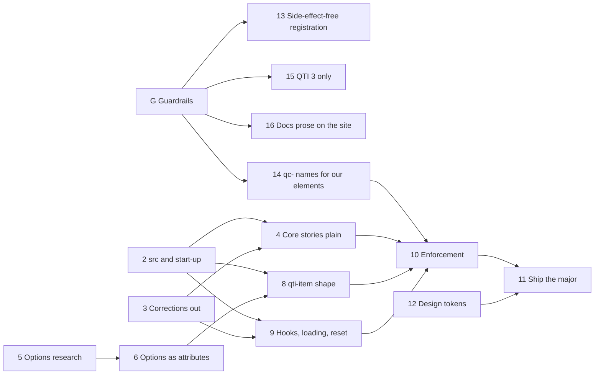

# Roadmap 5: the host API major

The fifth sub-roadmap (see [ROADMAP.md](ROADMAP.md)): the order in which [host-api.md](host-api.md)
is built. It starts when [roadmap 4](roadmap-adaptive-selection.md) is done, so every phase here can
rely on the test model, one computed context, the item session lifecycle and adaptive sections
from roadmaps 1 and 4. `host-api.md` says what the
API is and holds every decision; this file says what is built when. The rules in
[ROADMAP.md](ROADMAP.md) → "In every phase" apply.

Phase numbers are kept from the single roadmap they came from (phases 0, 1 and 7 left it), because
the rules, plans and code comments name them.

## Dependencies

Critical path: 5 → 6 → 8 → 10 → 11. Side by side, in separate worktrees: 2, 3, 5 and 12 from the
start; 4, 8 and 9 once their needs are done; 13–16 next to everything.

## Status

| #   | Phase                                           | Needs       | Status |
| --- | ----------------------------------------------- | ----------- | ------ |
| 2   | `src` on `qti-test` and start-up                | none        | todo   |
| 3   | Corrections out of the core                     | none        | todo   |
| 4   | Core stories in the plain markup                | 2, 3        | todo   |
| 5   | Options against QTI: research and docs page     | none        | todo   |
| 6   | Options as attributes, `config` as a view       | 5           | todo   |
| 8   | `<qti-item>` has the shape of `<qti-test>`      | 2, 6        | todo   |
| 9   | Hooks, `:state(loading)`, `reset`               | 2, 3        | todo   |
| 10  | Enforcement                                     | 4, 8, 9, 14 | todo   |
| 11  | Ship the major                                  | 10, 12      | todo   |
| 12  | Design tokens: one source for the tier-1 inputs | none        | todo   |
| 13  | Side-effect-free registration                   | G1          | todo   |
| 14  | `qc-` names for our own elements                | G1          | todo   |
| 15  | QTI 3 only                                      | G3          | todo   |
| 16  | Docs prose on the Astro site                    | G1          | todo   |

"none" means nothing beyond roadmaps 1–4.

## Phases

### 2. `src` on `qti-test` and start-up

Plan: [host-api.md](host-api.md) → `<qti-test>` properties, Decided "Start-up is explicit" (#328).
Scope: `qti-test`, `test-container`, the state mixin.

- [ ] `src` on `qti-test`; `test-url` on `test-container` a deprecated alias.
- [ ] `state` may be a promise; the seed in `session.seed`; `start-at`; `navigate` defaults to `item`.

- [ ] Host-migration entries from #328: Kennisnet (no change), CitoTestUit (`state = fetchState()`
      instead of its own first `navigateTo`), qti-player (`start-at` instead of `navigateTo` on load).

The `item` default ships only together with the promise `state` and `start-at`. On its own it was
tried and reverted: CitoTestUit leaves `navigate` unset and navigates itself once its state is in, so
a default start would show item 1 first.

Done when: `<qti-test src="…"><test-container></test-container></qti-test>` loads and starts, the
#328 play functions pass (a sync state opens the saved item with one navigation; a promise state
resolving after load never shows item 1; `null` opens item 1; `start-at` wins; `section` restores
the section), and CitoTestUit's start-up is checked against the new contract.

### 3. Corrections out of the core

Plan: [host-api.md](host-api.md) → Decided "The core does not know the corrections package" (#245).
Scope: `packages/qti-corrections`, the four interaction `*.styles.ts` with `full-correct-response`
(match, gap-match, associate, order), `qti-base` config, the item and interaction docs.

- [ ] Every correction method, property, attribute and option lives on the corrections package's
      extended elements; `correctResponseMode` and `fullCorrectResponseOnlyWhenIncorrect` leave the
      core `ConfigContext`.
- [ ] Correction stories, specs and VRT baselines move into the corrections package.
- [ ] The core names no corrections package (the #245 list, and `qti-test.host.api.stories.ts`).

Done when: `grep` finds no correction member or package name in the core, and the core builds and
tests without `@qti-components/corrections` installed.

### 4. Core stories in the plain markup

Plan: this file. Scope: core stories in `packages/qti-test`, `qti-elements`, `interactions/*`.

- [ ] Every core test story uses
      `<qti-test src="…"><test-container></test-container><nav><test-prev></test-prev><test-next></test-next></nav></qti-test>`,
      with no delivery option set.
- [ ] A story that needs an option moves to the options docs page (phase 5).

Done when: no core story sets an option; any failure is a departure from QTI and gets a line under
Found, to be fixed or turned into an option.

### 5. Options against QTI: research and docs page

Plan: [options-against-qti.md](options-against-qti.md). Docs only.

Done when: that plan's "Done when".

### 6. Options as attributes, `config` as a view

Plan: [host-api.md](host-api.md) → Delivery options, Decided "Options are attributes", "One disable
option", "Names". Scope: `qti-base` config, `qti-test`, interactions core.

- [ ] Every option that survives phase 5 is an attribute with a reflecting property.
- [ ] `config` reads and merges; `configContext` a deprecated alias.
- [ ] `disableAtMaxChoices` replaces both disable options.
- [ ] `itemData` and `setOutcomes`; the old names deprecated aliases.

Done when: each option works set as an attribute and through `config`, and the deprecated names warn once.

### 8. `<qti-item>` has the shape of `<qti-test>`

Plan: [host-api.md](host-api.md) → `<qti-item>`, Decided "`<qti-item>` has the shape of `<qti-test>`" (#236).
Scope: `packages/qti-item`.

- [ ] `src`, `xml`, `state`, `view`, `config`, `qtiContext`, `disabled`, `readonly`, the transform
      callback on `qti-item`; `item-container` keeps only the registry and the `<template><style>`.
- [ ] `QtiItemState` round-trips between a test and a standalone item; `qc-item-state-changed`.

Done when: an item state saved in a test restores into a `qti-item` and back.

### 9. Hooks, `:state(loading)`, `reset`

Plan: [host-api.md](host-api.md) → Hooks, Styling (#243), `<qti-test>` methods (#244).

- [ ] `qc-item-answer-key-shown` and `qc-item-correction-shown` (sent by the corrections package).
- [ ] `:state(loading)` on `qti-test` and `qti-item`.
- [ ] `reset(itemId?)` on `qti-test`, `reset()` on `qti-item`.

Done when: the Kennisnet table in Hooks has a story per row.

### 10. Enforcement

Plan: [host-api.md](host-api.md) → How this is enforced (#240, #251).

- [ ] Members not in `host-api.md` are `@internal` and stripped from the `.d.ts`; an API report in CI.
- [ ] The custom-elements manifest lists only the public members.
- [ ] Contract stories for every member; host-shaped tests (Kennisnet first).

Done when: CI fails on any change to the public surface that `host-api.md` does not list.

### 11. Ship the major

Plan: CLAUDE.md → Releasing.

- [ ] Survey PeilingLezen's 7.14 → 9.x gap.
- [ ] Every host-migration file complete for the major.
- [ ] Leave pre mode, merge `next` into `main`, release; cut `9.x` first.

### 12. Design tokens: one source for the tier-1 inputs

Plan: [design-tokens.md](design-tokens.md). Scope: `packages/qti-theme`, `tools/build`, the Theming
page, `.storybook/themes.css`, the docs site's styling guide. Touches no host-API code, so it runs
next to every other phase.

Done when: that plan's "Done when".

### 13. Side-effect-free registration

Plan: `.claude/rules/lit.md`. Scope: every package with elements.

- [ ] No `@customElement` decorator: a class file never defines its element; `register.ts` /
      `elements.ts` of each package does. The JSDoc `@customElement` tag stays (the CEM reads it).
- [ ] Importing a class module registers nothing; a spec imports every class module and finds
      `customElements` unchanged.

Done when: the corrections and qti-extended subclasses register without a double-define guard.

### 14. `qc-` names for our own elements

Plan: [host-api.md](host-api.md) → Decided "Our elements are `qc-`". Scope: `test-*`,
`item-container`, `test-container`, the qti-extended plugins, QTI-Editor in step. `qti-test` and
`qti-item` keep their names.

- [ ] Every element that is ours, not 1EdTech's, takes `qc-`, except the host elements `qti-test` and
      `qti-item`; the old name is a deprecated alias for one major that warns once.
- [ ] The remaining `qti-` theme hooks (`qti-dialog`, `qti-theme-kennisnet`,
      `qti-graphic-order-marker`, `qti-base-stimulus`, `qti-shared-stimulus`) are renamed.
- [ ] Host-migration entries for every host; the docs and stories use the new names.

Done when: a vocabulary spec finds no `qti-` name in our elements (other than `qti-test` and
`qti-item`), events, attributes or tokens that QTI does not define.

### 15. QTI 3 only

Plan: `.claude/rules/qti-spec.md`. Scope: `qti-transformers`, the docs.

- [ ] QTI 2.x input is no longer supported: the 2.x transforms and their docs go; hosts that feed
      2.x items get a host-migration entry.

Done when: nothing in the published packages or the docs mentions QTI 2.x as supported.

### 16. Docs prose on the Astro site

Plan: `.claude/rules/docs.md`. Scope: `docs/*.mdx`, `apps/site`.

- [ ] Every prose page lives in `apps/site`; Storybook keeps autodocs and live examples and links
      to the site. No page exists in both.
- [ ] Each qti-extended plugin has a site page.

Done when: `docs/` holds no prose page that the site also has, and every Storybook docs page that
remains is a live example.
