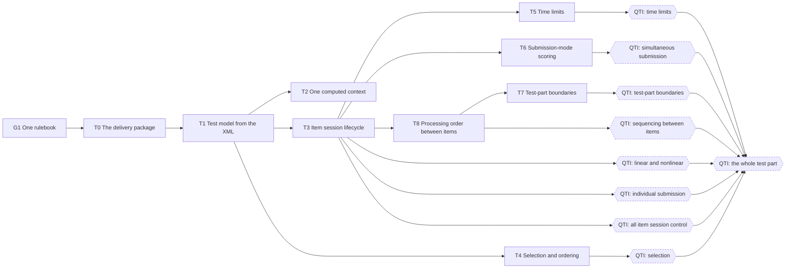

# Roadmap 1: QTI test navigation

The first sub-roadmap (see [ROADMAP.md](ROADMAP.md)): moving through a `qti-assessment-test` as
QTI 3 says, in full: navigation and submission mode, item session control, the processing order
between items, test-part boundaries, selection, ordering and time limits. It is built first;
roadmap 2, the CitoTestUit server pilot, and roadmap 3, pure processing, start when it is done. Each phase is its own PR or PRs into `next`; the rules in
[ROADMAP.md](ROADMAP.md) → "In every phase" apply.

The rules live in a new package, `@qti-components/delivery` (QTI's "delivery engine"): the test
model, the item session lifecycle, sequencing and the session state, with no Lit, no globals of the
browser and no custom elements, so the same code can later run on a Node server (decided
2026-10-30, "keep the door open"). `test-navigation` stays the element that provides
`computedContext`, now by calling `delivery`; `<test-stamp>` stays and renders from it. Building
the model, combining the context and the rules are kept apart; loading is untouched.

## Dependencies

The hexagons are not phases: they mark when a QTI test feature is complete (see QTI test support).

Critical path: G1 → T0 → T1 → T3 → T8 → T7. Side by side, in separate worktrees: T2, T3 and T4 after
T1; T5, T6 and T8 after T3; T7 after T8.

## Status

| #   | Phase                                  | Needs | Status |
| --- | -------------------------------------- | ----- | ------ |
| T0  | The delivery package                   | G1    | todo   |
| T1  | The test model from the XML            | T0    | todo   |
| T2  | One computed context                   | T1    | todo   |
| T3  | The item session lifecycle             | T1    | todo   |
| T4  | `qti-selection` and ordering           | T1    | todo   |
| T5  | `qti-time-limits`                      | T3    | todo   |
| T6  | Scoring that follows `submission-mode` | T3    | todo   |
| T7  | Test-part boundaries                   | T8    | todo   |
| T8  | The processing order between items     | T3    | todo   |

## QTI test support

What a test part supports from QTI 3, today and after which phase. Today is read from source on
2026-10-30, not run against the conformance suite.

| QTI                                                                                                | Today                                                                      | Complete after |
| -------------------------------------------------------------------------------------------------- | -------------------------------------------------------------------------- | -------------- |
| `navigation-mode` linear / nonlinear                                                               | works, but also read off sections, which QTI does not allow                | T1 (T1d), T3   |
| `submission-mode` individual                                                                       | attempts, end attempt and the lock work; rules spread over five components | T3             |
| `submission-mode` simultaneous                                                                     | items not locked; responses not processed when the part is submitted       | T6             |
| `qti-item-session-control` cascade (part → sections → ref)                                         | nested sections do not inherit from their parent section                   | T1 (T1a, T1b)  |
| `max-attempts`                                                                                     | works (the attempts lock)                                                  | T3             |
| `show-feedback`                                                                                    | works (`qti-feedback`)                                                     | T3             |
| `show-solution`                                                                                    | works in the corrections package (`TestNavigationCorrection`)              | T3             |
| `allow-skipping`                                                                                   | carried; only `test-end-attempt` checks it                                 | T3             |
| `allow-review`                                                                                     | declared on the element only, no effect                                    | T3             |
| `validate-responses`                                                                               | declared on the element only, no effect                                    | T3 (T3c)       |
| `allow-comment`                                                                                    | declared on the element only, no effect                                    | T3 (T3c)       |
| Test outcome processing after every submission (§2.9)                                              | runs only on `submit()` and for `getTestFeedback()`                        | T8             |
| Order on leaving an item: RP, OP, branch rules, pre-conditions, template processing (impl. §4.5.3) | branch rules and pre-conditions read stale test outcomes                   | T8             |
| `qti-pre-condition`, `qti-branch-rule` on items and sections                                       | work in linear parts, the next item in line only                           | T8             |
| `qti-pre-condition`, `qti-branch-rule` on test parts (always considered)                           | only when the current part is linear                                       | T8             |
| Test parts in order, no return to an earlier part                                                  | item-refs are one flat list across parts                                   | T7             |
| Unsubmitted responses at the end of a nonlinear individual part                                    | not signalled                                                              | T7             |
| `qti-test-feedback` on a test part (`atEnd` of the part)                                           | `getTestFeedback()` knows the whole test only                              | T7             |
| `qti-ordering`                                                                                     | works; a subsection dissolves on `keep-together="false"` even when visible | T4             |
| `qti-selection`                                                                                    | not supported                                                              | T4             |
| `qti-time-limits`                                                                                  | not supported                                                              | T5             |
| `qti-adaptive-selection` (CAT)                                                                     | not supported                                                              | roadmap 4      |

This roadmap is done when every row up to adaptive selection is complete: the whole test part is QTI.

## Phases

### T0. The delivery package

Plan: this section. Scope: a new `packages/qti-delivery` (`@qti-components/delivery`, public,
starting at 0.x), `packages/qti-components`, `packages/qti-test`.

- [ ] The package: plain TypeScript, no Lit, no `window`, `document`, `customElements` or
      `HTMLElement`. An XML `Document` is passed in, never read from a global, so a server can pass
      one from `@xmldom/xmldom`. A spec runs the package in the `tests` project under Node and fails
      on any of those globals.
- [ ] Published, at 0.x on its own version line (changesets has no `fixed` group), so a Node
      server installs it; `@qti-components/test` depends on it and `@citolab/qti-components` inlines
      it like the other packages. `host-api.md` lists it as experimental until roadmap 2 has
      settled its interface.
- [ ] One interface: commands in (`beginAttempt`, `endAttempt`, `navigate`, `endTestPart`,
      `timeUp`), the new session state and effects out ("load item", "run response processing",
      "show test feedback"). Today `test-navigation` answers the effects locally.
- [ ] A seam for processing: `delivery` asks for response and outcome processing through an
      interface; today the existing `qti-processing` elements do the work.
- [ ] The session state is a versioned JSON schema, keyed by item instance (one item-ref can
      appear more than once with `with-replacement`); the clock is passed in; the seeded shuffle of
      `qti-transformers` moves here, so every runtime gets the same order from the same seed.
- [ ] Specs as JSON test vectors (a test, a list of commands, the expected states), so a later .NET
      port runs the same files.

Done when: the package runs under Node with no browser globals, publint and attw pass on it, and
the vectors pass.

Not here, each with a slot in [ROADMAP.md](ROADMAP.md): a processor that runs without the DOM
(roadmap 3), a server, `test-container` holding only the current item, a .NET port.

### T1. The test model from the XML

Plan: [test-model.md](test-model.md).
Scope: `packages/qti-test` (`test-navigation`, the navigation mixin, `test-next`,
`qti-assessment-section`), `packages/qti-base` (`computed.types.ts`).

- [ ] T1a The test model from the test XML, not the live DOM; nested sections right.
- [ ] T1b All seven session-control attributes, resolved, as `item.sessionControl`.
- [ ] T1c Item facts from the item XML.
- [ ] T1d Navigation and submission mode from the test part only.

Done when: that plan's "Done when".

### T2. One computed context

Plan: [computed-context.md](computed-context.md).
Scope: `packages/qti-test` (`test-navigation`), `packages/qti-extended` (`test-stamp`),
`packages/qti-base` (`computed.types.ts`).

- [ ] T2a `stampContext` merged into `computedContext.active`.
- [ ] T2b Host `itemData` under `item.data`, no longer overriding computed fields.

Roadmap 5's phase 6 renames the host input (`initContext` → `itemData`); T2 decides where it lands.

Done when: that plan's "Done when".

### T3. The item session lifecycle

Plan: [item-lifecycle.md](item-lifecycle.md).
Scope: `packages/qti-test` (`test-navigation`, `test-next`, `test-prev`, `test-end-attempt`),
`packages/qti-base` (`qti-feedback`), `packages/qti-corrections`.

- [ ] T3a The item session lifecycle (QTI 3 info model §2.2.1) as a finite state machine per item.
- [ ] T3b One rules module that drives the machine; the buttons, the lock and feedback read its state.
- [ ] T3c `validate-responses` and `allow-comment` take effect.

Done when: that plan's "Done when".

### T4. `qti-selection` and ordering

Plan: this section. Scope: `packages/qti-transformers` (next to `shuffleOrdering`), `qti-test`.

- [ ] Apply `qti-selection` (`select`, `with-replacement`, `qti-selection` with required refs) at
      load, seeded like the ordering, so a resumed session gets the same items.
- [ ] The T1 model holds only the selected item-refs.
- [ ] Ordering dissolves a subsection only when `visible` and `keep-together` are both false
      (`shuffle-sections.ts`), as implementation guide §4.5.2 says.

Done when: selection stories pass with a fixed seed, and the same seed selects the same items.

### T5. `qti-time-limits`

Plan: to write before the phase starts. Scope: `qti-test`, the T3 machine.

- [ ] `min-time`, `max-time` and `allow-late-submission` on the test, part, section and item-ref.
- [ ] `duration` counts `interacting` only; running out of time ends the item session or the part
      through the T3 machine.

Done when: a time limit at each level ends what it limits, and `duration` excludes suspended time.

### T6. Scoring that follows `submission-mode`

Plan: [submission-mode-scoring.md](submission-mode-scoring.md) (#299). Was roadmap phase 7; it moved
here because simultaneous submission is not QTI without it. Its proposal to deprecate
`auto-score-items` waits for roadmap 5's options research (phase 5).

Done when: that plan's "Done when".

### T7. Test-part boundaries

Plan: to write before the phase starts. Scope: the navigation mixin, the T3 machine,
`test-processing.mixin.ts`.

- [ ] Test parts follow each other: navigation stays inside the current part, leaving it ends the
      part (its item sessions close, a simultaneous part is submitted) and an earlier part cannot be
      entered again (info model §2.8.2).
- [ ] At the end of a nonlinear part with individual submission, unsubmitted responses are
      signalled, so a host can ask the candidate to submit or discard them.
- [ ] Test feedback per `access` and per scope, with "feedback" as a navigation target next to item
      and section. Its behaviour and specs are those of Citolab/qti-components#197 (open into
      `main`: `during` shows as soon as its outcome matches, `atEnd` becomes available when its test
      part or the test ends and opens through `<test-show-feedback>`); T7 moves that logic into
      `delivery`, from the model and the test outcomes, without changing it.

Done when: a two-part test cannot navigate back into part 1, and each part's feedback shows at its end.

### T8. The processing order between items

Plan: to write before the phase starts. Scope: `test-processing.mixin.ts`,
`internal/item-sequencing.ts`, the T3 machine.

- [ ] Test outcome processing runs after every submission: per item in an individual part, per
      part in a simultaneous one (info model §2.9).
- [ ] Leaving an item runs, in order: response and outcome processing, branch rules (item, then
      sections from the inside out, then the test part), pre-conditions on the target, then
      template processing of the next item (implementation guide §4.5.3).
- [ ] Pre-conditions and branch rules on a test part are always considered, also when the part is
      nonlinear; on items and sections only in linear parts.
- [ ] Sequencing reads the T1 model and test variables, not the live DOM.

Done when: a branch rule on a test outcome set by the previous item fires, and a part-level
pre-condition skips a part after a nonlinear one.
